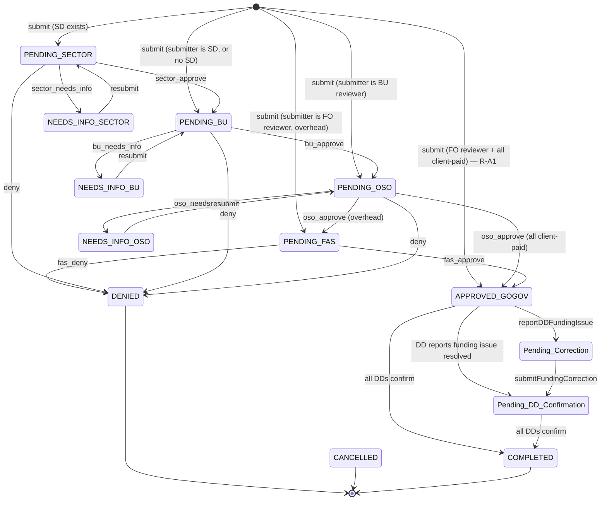

# LETS Business Logic as Implemented — Pass 4

| Field | Value |
|---|---|
| **Title** | LETS Business Logic as Implemented (Pass 4) |
| **Purpose** | Document the *actual implemented behavior* of the budget engine, approval routing, FAS tracker sync, per-diem services, and reconciliation — and state plainly where it differs from documented intent. |
| **Date generated** | 2026-10-27 |
| **Prerequisite reading** | [FILE_MANIFEST.md](./FILE_MANIFEST.md) · [ENTRY_POINTS_AND_ROUTING.md](./ENTRY_POINTS_AND_ROUTING.md) · [DATA_LAYER_PASS3.md](./DATA_LAYER_PASS3.md) |

## Confidence summary

| Evidence class | Share | Scope |
|---|---|---|
| `[VERIFIED]` | ~88% | All routing, status-transition, cost, and budget logic read directly in code. **Additionally, I executed the budget engine and request service under Node to observe real outputs** rather than reasoning about them — every numeric claim and every edge-case behavior below is an observed result, not a prediction. |
| `[INFERRED]` | ~5% | Intent behind unfinished logic, and consequences in live conditions I cannot reproduce (concurrency, Apps Script quota). Reasoning given each time. |
| `[CLAIMED]` | ~3% | Documented behavior with no implementing code. |
| `[UNKNOWN]` | ~4% | Live Script Property values (mileage rates, other-cost %), the real contents of `Set_Asides`/`Budgets`, and the FAS tracker's actual status vocabulary. |

---

## 4.0 The central fact of Pass 4

**There are two complete, parallel, mutually incompatible business-logic implementations in this repository.**

| | **System A — the TRIP workflow** | **System B — the LETS budget workflow** |
|---|---|---|
| What it governs | Who approves a travel request, and the cost of that travel | Whether money exists to pay for it |
| Reachable by a user? | **Yes** — this is what runs today | **No** — zero callers (Pass 2, R-5) |
| Approval model | 4-stage cascade: Sector → BU → AAS FO → FAS, resolved from `Travel_User_Roles` + HC staffing | Single office-level approver pair from `Org_Approvers` |
| Status vocabulary | 15 `STATUS_CODES` | 12 `LETS_CONFIG.requestStatus` — **zero overlap** |
| Money logic | Computes **cost** per traveler/leg (per-diem, mileage, lodging) | Computes **budget availability** and blocks overspend |
| Budget awareness | **None.** No budget check exists anywhere in the live path | The entire point |
| Cost awareness | Full GSA/DoD/DOS per-diem integration | None — accepts flat numbers typed by a user |
| Test coverage | None (no test files for it) | 3 Node suites, all passing |

Neither is a superset of the other. **System A can approve a $500,000 trip without consulting any budget. System B can verify funds for a trip whose cost nobody computed.** The documented product — "mandatory budget check before approval routing" — requires joining them, and that join does not exist.

Everything below documents each system separately, then the join.

---

## 4.1 System A: the approval workflow (live)

### 4.1.1 Initial routing — the "smart routing" cascade

On submission, `determineInitialRouting(submitterEmail, sectorDirector, buReviewer, travelers)` `[VERIFIED]` `40_domain/Submission.js:74-193` decides the first reviewer in two phases.

**Phase 1 — skip rules ("you cannot review your own request"):**

| Condition | Start stage | Code |
|---|---|---|
| Submitter **is** the AAS FO (OSO) reviewer | `FAS` | `:100-101` |
| Submitter **is** the BU reviewer | `OSO` | `:102-103` |
| Submitter **is** the Sector Director | `BU` | `:104-105` |
| A Sector Director exists for the submitter's sector | `Sector` | `:106-107` |
| No Sector Director found | `BU` | `:108-110` |

**Phase 2 — vacancy cascade.** Walks `Sector → BU → OSO → FAS`, skipping any stage whose reviewer has no email `[VERIFIED]` `:118-158`.

**Terminal branch at FAS** `[VERIFIED]` `:161-183` — and this is the most consequential rule in System A:

| Travelers include any **overhead**-funded person? | Outcome |
|---|---|
| Yes | → `PENDING_FAS`, assigned to the active `fas_fo_reviewer` primary |
| No (all client-paid) | → **`APPROVED_GOGOV` immediately. No human approval at all.** |

The overhead test is lenient and inverted: `!val || val === 'overhead'` — **a blank `Is_Client_Paid` counts as overhead** `[VERIFIED]` `Review_Action.js:528-529`. That is the correct conservative default (blank routes *into* review rather than around it), and it is worth preserving if anyone refactors it.

**Fallback** `:186-192`: if the chain somehow exhausts, the request lands at `PENDING_OSO` with whatever OSO reviewer exists — possibly an empty email, which strands the request with no assignee.

### 4.1.2 Rule R-A1 — a submitter can be auto-approved with no review whatsoever

Combining 4.1.1's two phases: if the **AAS FO reviewer** submits a request where **every traveler is client-paid**, Phase 1 sets the start stage to `FAS`, and the FAS branch sees no overhead, so the request is written directly as `APPROVED_GOGOV` `[VERIFIED]` `Submission.js:100-101` → `:174-182`.

No Sector, no BU, no FO, no FAS, no email to any approver. The `Approval_Log` records a single `Submitted` row. This is self-approval by design of the skip rules, and it is reachable today.

Whether that is acceptable is a policy question, not mine to answer. It must be a *conscious* policy decision, and it is currently an emergent side effect of two independently reasonable rules. Flagging it for the ISSO and the business owner.

### 4.1.3 The state machine, as implemented

`getActionConfig(action, currentStatus)` `[VERIFIED]` `Review_Action.js:303-414` is the single source of transition truth. Thirteen actions:

| Action | Valid only from | → New status | Comments required | Role |
|---|---|---|---|---|
| `sector_approve` | `PENDING_SECTOR` | `PENDING_BU` | no | `Sector_Director` |
| `sector_needs_info` | `PENDING_SECTOR` | `NEEDS_INFO_SECTOR` | **yes** | `Sector_Director` |
| `bu_approve` | `PENDING_BU` | `PENDING_OSO` | no | `BU_Reviewer` |
| `bu_needs_info` | `PENDING_BU` | `NEEDS_INFO_BU` | **yes** | `BU_Reviewer` |
| `oso_approve` | `PENDING_OSO` | `PENDING_FAS` *(or `APPROVED_GOGOV` if client-paid — see below)* | no | `OSO_Reviewer` |
| `oso_needs_info` | `PENDING_OSO` | `NEEDS_INFO_OSO` | **yes** | `OSO_Reviewer` |
| `fas_approve` | `PENDING_FAS` | `APPROVED_GOGOV` | no | `Admin` |
| `fas_deny` | `PENDING_FAS` | `DENIED` | **yes** | `Admin` |
| `deny` | any of the 3 `PENDING_*` (not FAS) | `DENIED` | **yes** | `Reviewer` |
| `cancel` | anything not `COMPLETED`/`CANCELLED`/`DENIED` | `CANCELLED` | **yes** | `Reviewer` |
| `submitter_cancel` | same | `CANCELLED` | no | `Submitter` |
| `resubmit` | the 3 `NEEDS_INFO_*` | back to the matching `PENDING_*` | no | `Submitter` |

**A runtime override sits on top of this table.** For `oso_approve`, the handler re-reads traveler rows and, if no traveler is overhead, rewrites the outcome to `APPROVED_GOGOV`, skipping FAS entirely `[VERIFIED]` `Review_Action.js:114-143`. So the declared `newStatus` in the config table is not always the status written — a subtlety that will bite anyone who reads only `getActionConfig`.



**Note what is absent from this diagram: `DRAFT` has no transition into the workflow.** `STATUS_CODES.DRAFT` exists and is listed as editable `Review_Update.js:269`, but nothing writes it — `submitTravelRequestV2` writes the routed status directly `[VERIFIED]` `Submission.js:293`. Drafts live client-side in IndexedDB (`travelRequestDraftStorage.html`), never in the database. So `DRAFT` is a vestigial status value.

### 4.1.4 The DD confirmation sub-workflow

After `APPROVED_GOGOV`, each traveler's Division Director must confirm funding `[VERIFIED]` `Review_DDConfirm.js`:

| Step | Function | Writes |
|---|---|---|
| DD confirms their travelers | `confirmDDTravelers` `:290` | `DD_Confirmed`=TRUE, `DD_Confirmed_At` per traveler row |
| When **every** traveler row is confirmed | same function `:355-371` | request → `COMPLETED`, logs `ALL_DD_CONFIRMED` |
| DD reports a funding problem | `reportDDFundingIssue` `:420` | request → `Pending_Correction`; writes `DD_Flagged_Travelers` (JSON), `DD_Issue_Notes`, `DD_Issue_Reporter` — **creating those 3 columns if absent** (Pass 3, D-9) |
| Submitter fixes funding | `submitFundingCorrection` `:702` | request → `Pending_DD_Confirmation`, clears the 3 DD fields, re-emails only affected DDs |

Authorization here is purely record-level: the caller's email must equal a traveler's `DD_Email` `[VERIFIED]` `:330`. No role check. A person who is nobody's DD simply matches no rows and confirms nothing — a benign failure, but note `getFundingCorrectionData` `:605` has **no check at all** and will return any request's flagged-traveler details and DD notes to any caller (Pass 2, R-4).

### 4.1.5 Rule R-A2 — `COMPLETED` means "funding confirmed," not "travel happened"

This is a naming trap with real consequences. `COMPLETED` is reached when the last DD confirms funding `[VERIFIED]` `:364-369` — which happens **before the trip occurs**. There is no post-travel state in System A at all:

- No "travel complete" status.
- No actual-cost capture. `Request_Travelers` has 38 columns of **estimates** and no actuals columns `[VERIFIED]` (Pass 3 appendix).
- No reconciliation. The only place actuals were ever meant to live is System B's `Travelers` tab, which has no writer (Pass 3, D-8).

So **System A is an approval system that stops at approval.** An administrator reading a dashboard that says "COMPLETED" is seeing *funding confirmed pre-travel*, not *trip finished and paid*. Any report of "actual spend" built on System A data would be reporting estimates.

### 4.1.6 Fiscal year and quarter derivation — three implementations, one of them mislabelled

| Function | Definition | Correct? |
|---|---|---|
| `getFiscalYear(date)` `PerDiemGSA.js:487` | month ≥ 10 → year+1, using a **1-indexed** month from `parseDateString` `:473` | **Yes.** Oct–Dec → next FY |
| `getFiscalYearRange(fy)` `PerDiemGSA.js:501` | Oct 1 (fy−1) → Sep 30 (fy) | **Yes** |
| `period === 'fy'` `Admin_Dashboard.js:479`, `ReviewerDashboard.js:470` | `getMonth() >= 9` (0-indexed, so 9 = October) → Oct 1 this year, else Oct 1 last year | **Yes** |
| `period === 'quarter'` `Admin_Dashboard.js:474-477`, `ReviewerDashboard.js:465-468` | `qStartMonth = month>=9?9 : month>=6?6 : month>=3?3 : 0` → quarters starting **Jan, Apr, Jul, Oct** | **These are CALENDAR quarters.** |

The quarter calculation is arithmetically fine but **`ReviewerDashboard.js:468` labels it `'FY Quarter'`** `[VERIFIED]`. Federal Q1 is Oct–Dec; this code's "Q1" is Jan–Mar. So for three months of every year — January through March — the dashboard shows data for federal **Q2** under a label saying **Q1**.

Worth fixing because it is both wrong and cheap to correct: either relabel to "Calendar Quarter" or shift the boundaries. The two different implementations of the same logic in two files should also be collapsed to one.

### 4.1.7 Cost calculation — the part of System A that is genuinely complete

`30_services/Costs.js` (1,083 lines) is substantial, correct-looking work `[VERIFIED]`:

| Rule | Implementation | Notes |
|---|---|---|
| **M&IE 75% first/last day** | `calculateMieTotal` `:326-373` builds a day-by-day breakdown; first day, last day, **and any single-day trip** get 75% | Matches FTR. Clean implementation with a per-day audit trail. |
| Lodging paid per **night**, not per day | `calculateLodgingTotal` `:294`, `calculateNights` `:254` | Correct distinction |
| Per-diem source routing | `getPerDiemForLeg` `:90` dispatches to GSA (CONUS) / DoD (OCONUS) / DOS (foreign) | 3 services behind one interface |
| Mileage | `calculateTransportationTotal` `:392`; `'private'` vs `'gov'` rates `:400,404` | Rates from Script Properties |
| "Other costs" gross-up | `calculateOtherCosts` `:499`, default **15%** | Documented as the "GO.gov gross-up" `01_constants/Costs.js:13` |
| Overrides with reason capture | Lodging and M&IE both support `{enabled, amount, reason}` `:294,326`; stored in `Traveler_Leg_Costs` | Good auditability |

**Configurable rates and their defaults** `[VERIFIED]`:

| Script Property | Read by | Default if unset | Live value |
|---|---|---|---|
| `MILEAGE_RATE_PRIVATE` | `getPrivateMileageRate()` `Props.js:89` | `0.70` | `[UNKNOWN]` |
| `MILEAGE_RATE_GOV` | `getGovMileageRate()` `Props.js:98` | `0.22` | `[UNKNOWN]` |
| `other_cost_percentage` | `getOtherCostPercentage()` `Props.js:117` | `15` | `[UNKNOWN]` |
| `GSA_PERDIEM_API_KEY` | `PerDiemGSA.js:16` | none — CONUS lookups fail | `[UNKNOWN]` |

### 4.1.8 Rule R-A3 — the config initializer writes property keys nobody reads

`initTravelSystemConfig()` `[VERIFIED]` `Database.js:446-481` iterates `TRAVEL_DB_CONFIG.defaults` and writes each key **lower-cased**: `props.setProperty(key.toLowerCase(), …)` `:454`.

Cross-referencing what it writes against what any getter reads:

| Written by the initializer | Read anywhere? |
|---|---|
| `private_mileage_rate` | **No** — readers use `MILEAGE_RATE_PRIVATE` `Props.js:25` |
| `gov_mileage_rate` | **No** — readers use `MILEAGE_RATE_GOV` `Props.js:26` |
| `local_travel_threshold` | **No** — the string appears once, at its own definition `Database.js:26` |
| `drive_folder_id` | **No** — readers use `SHARED_DRIVE_FOLDER_ID` |
| `other_cost_percentage` | **Yes** |
| `travel_email_address` | **Yes** |
| `travel_email_name` | **Yes** |

So **4 of 7 defaults are written to dead keys.** An administrator who runs the documented "initialize system config" step and then sets mileage rates expecting them to apply will find the rates unchanged — the app silently uses the hardcoded `0.70`/`0.22` fallbacks. The failure is invisible: no error, plausible-looking numbers.

Note also that `TRAVEL_DB_CONFIG.defaults.DRIVE_FOLDER_ID` is a hardcoded Drive ID `'1BVAqc5GM6L5LAE85kW94uGHLNwIAa3e'` `[VERIFIED]` `Database.js:27` — an asset identifier embedded in source, written to a key nobody reads. Add it to the asset inventory; it is the only hardcoded Drive folder in the codebase.

---

## 4.2 System B: the budget engine (unwired, but arithmetically sound)

`30_services/BudgetEngine.js` is a pure-function module with nine exports and no side effects `[VERIFIED]`. I ran it directly under Node to capture real outputs.

### 4.2.1 The core formula, and what it produces

```
Remaining Discretionary Balance =
      Baseline Allocation
    + Mid-Year Adjustments            (from Budget_Adjustments, filtered by officeCode)
    − Self-Funded Set-Asides          (100% charged to the target office)
    − Share of Enterprise Set-Asides  (amount × that office's proportional share)
    − Pending Estimated Costs         (requests in any of 8 "in-flight" statuses)
    − Posted Actual Costs             (requests in RECONCILED status)
```
`[VERIFIED]` `BudgetEngine.js:176-239`

**Observed output** for FY27 with no requests, using the config-shaped state the tests use `[VERIFIED]` by execution:

| Office | Baseline | Prop. share | Self-funded set-asides | Enterprise share | Discretionary base | Remaining |
|---|---|---|---|---|---|---|
| FO | $4,000 | 0 | $0 | $0 | $4,000 | **$4,000** |
| OMD | $152,000 | 0.153 | $12,000 | $3,060 | $136,940 | **$136,940** |
| IDV | $659,000 | 0.664 | $12,000 | $13,280 | $633,720 | **$633,720** |
| CM | $182,000 | 0.183 | $64,500 | $3,660 | $113,840 | **$113,840** |
| **Portfolio** | **$997,000** | — | **$108,500 total** | — | — | **$888,500** |

These are exactly the figures hardcoded into the `?mode=budget` dashboard and the balance ticker in `letsAppLayout.html` `[VERIFIED]` — confirming Pass 2's conclusion that the mockup was built from real engine output.

CM's $64,500 is $12,000 DAC LC + $52,500 COE Program, both self-funded to CM `[VERIFIED]` `BudgetConfig.js:58-73`.

### 4.2.2 Rule R-B1 — the Front Office pays nothing toward its own gap

The `SETASIDE_FO_LC_GAP` set-aside ($20,000, `ENTERPRISE_SHARED`, target `SHARED_DAC`) is described as covering the Front Office LC travel gap, shared across the three DACs `[VERIFIED]` `BudgetConfig.js:75-82`.

The implementation spreads it by proportional share `BudgetEngine.js:103-114`. Observed: OMD $3,060 + IDV $13,280 + CM $3,660 = **$20,000** exactly. The arithmetic closes.

But FO's own breakdown shows the set-aside listed with `proportionalShare: 0` and `appliedDeduction: 0` `[VERIFIED]` by execution — because FO has no `standardProportionalShare` in config (it is `isDac: false`). So FO keeps its full $4,000 while the DACs fund the $20,000 gap on its behalf.

That is almost certainly the intent ("Shared ASD responsibility covering Front Office LC travel gap"), and the shares sum correctly. I flag it only because the FO breakdown *lists* a set-aside it is not charged for, which will look like a bug to anyone reading a future dashboard. Worth a comment in the code or a filtered display.

### 4.2.3 Which statuses consume budget — observed, not assumed

I ran every one of the 12 `LETS_CONFIG.requestStatus` values through `calculateSpendAndCommitments` with est=$1,000 / act=$900 `[VERIFIED]` by execution:

| Status | Counted as pending | Counted as posted |
|---|---|---|
| `Draft` | — | — |
| `Submitted - Pending Budget Check` | **$1,000** | — |
| `Budget Check Passed` | **$1,000** | — |
| `Flagged - Insufficient Funds` | **$1,000** | — |
| `Pending Exception Approval` | **$1,000** | — |
| `Pending Leadership Review` | **$1,000** | — |
| `Approved` | **$1,000** | — |
| `Booked / Travel Ready` | **$1,000** | — |
| `Travel Completed` | **$1,000** | — |
| `Rejected` | — | — |
| `Cancelled` | — | — |
| `Reconciled / Actuals Posted` | — | **$900** |

**Double-counting prevention works as documented.** A reconciled request's estimate is dropped and only its actual is charged `BudgetEngine.js:155-164`. `Rejected` and `Cancelled` release the commitment. `Draft` never commits. This is correct, and the handoff documentation's §3C claim about double-counting prevention is one of the few claims that holds up.

### 4.2.4 Rule R-B2 — reconciling with blank actuals silently frees the whole commitment

Observed `[VERIFIED]` by execution: a $50,000 request set to `Reconciled / Actuals Posted` with `totalActualCost = 0` yields `pendingEstimates: 0, postedActuals: 0`.

The $50,000 commitment vanishes from the budget and nothing replaces it. Because `RECONCILED` is checked *before* the pending-status list `:159`, the status alone releases the estimate regardless of whether actuals were entered.

**Consequence:** marking trips reconciled without entering actuals — the single most likely data-entry mistake in a reconciliation workflow — inflates the available balance by the full estimate of every such trip. There is no guard: no check that `totalActualCost > 0`, no variance threshold, no warning. Combined with R-B3 below, this is the most financially dangerous behavior in System B.

**Suggested fix for the backlog:** require `totalActualCost > 0` before honouring `RECONCILED`, or treat `RECONCILED` with zero actuals as still-pending and surface it on an exceptions report.

### 4.2.5 Rule R-B3 — `reconcileRequest` overwrites the original estimate

`reconcileRequest(requestId, actualTravelersData, state)` `[VERIFIED]` `RequestService.js:122-144` recomputes **both** totals from the payload it is handed:

```javascript
request.totalEstimatedCost = travelerRec.totalEstimatedCost;   // <-- overwritten
request.totalActualCost    = travelerRec.totalActualCost;
request.variance           = travelerRec.variance;
```

Observed: a request submitted at $1,000 estimated, reconciled with a payload carrying `estAirfare: 100, actAirfare: 9999`, ends with `totalEstimatedCost: 100`, `totalActualCost: 9999`, `variance: 9899` `[VERIFIED]` by execution.

**The original approved estimate is destroyed.** Variance is then computed against whatever estimate the reconciler supplied, not against what was approved — which defeats the purpose of variance tracking. Any audit asking "what did we approve versus what did we spend" cannot be answered from this data.

Two further gaps in the same function: it accepts reconciliation **from any status** (observed: reconciled straight from `Submitted`, no requirement of `Travel Completed`), and it mutates the request object in place and returns it, assuming a caller will persist it — with no caller, nothing does (Pass 3, D-8).

### 4.2.6 Rule R-B4 — the budget gatekeeper's self-exclusion breaks on blank IDs

`evaluateBudgetCheck(request, state)` `[VERIFIED]` `BudgetEngine.js:242-269` excludes the request under evaluation from the committed total so a re-check does not double-count it:

```javascript
const filteredRequests = (state.requests || []).filter(r => r.requestId !== request.requestId);
```

Correct for well-formed data. But when `requestId` is `undefined` or `''` on both sides, the filter removes **every** request sharing that blank value.

Observed `[VERIFIED]` by execution: two existing OMD requests ($100,000 and $30,000, both with blank `requestId`) plus a new $5,000 request with a blank ID → the gate reports an available balance of **$106,940 and approves**, versus **$6,940** when the new request carries a real ID. $130,000 of commitments were erased from the calculation by one empty string.

`RequestService.createTravelRequest` generates an ID before calling the gate `:58`, so the live path would not hit this — but the gate is a public export callable with anything, and ID generation itself is unreliable (R-B5). Worth an explicit guard.

### 4.2.7 Rule R-B5 — `LETS-` request IDs are count-based and collide

`generateRequestId(existingCount)` returns `LETS-<year>-<count+1 zero-padded>` `[VERIFIED]` `RequestService.js:35-38`. The caller passes `state.requests.length` `:57`.

Observed `[VERIFIED]` by execution: three calls with the same count return `LETS-2027-003` three times. And because it counts rather than reading the maximum, **deleting any request causes the next ID to reuse a number that already exists.**

This is a different and worse defect than System A's `generateRequestId` (Pass 3, D-4), which at least reads the max. Both lack locking. Note too that the year comes from `CONFIG.fiscalYear.replace('FY','20')` — the string `'FY27'` → `'2027'` `:36` — so **every ID is stamped FY27 permanently** until someone edits the config. Changing fiscal year is a code change, not a configuration change.

### 4.2.8 Other observed behaviors worth recording

| # | Behavior | Observed result | Assessment |
|---|---|---|---|
| R-B6 | Unknown `owningOffice` (e.g. `'ZZZ'`) | Returns `officeName: 'ZZZ'`, balance $0, `hasSufficientFunds: false` | **Fails closed — good.** No crash, no silent pass. |
| R-B7 | Negative estimated cost (−$999,999) | `hasSufficientFunds: true`, projected balance **$1,136,939** | **No input validation.** A negative cost *increases* the apparent budget. Needs a `>= 0` guard. |
| R-B8 | Set-aside rows marked `Active: 'FALSE'` | Still deducted in full — OMD set-asides remain $15,060 | The `Active` column exists in the schema `LetsDB.js:95` and is **never read** `BudgetEngine.js:91-116`. Deactivating a set-aside has no effect. (Pass 3, Appendix 3B) |
| R-B9 | `calculateProportionalShares(..., useStoredShares=true)` default | Uses the fixed config shares (0.153/0.664/0.183), **ignoring** mid-year adjustments | Deliberate — the parameter exists to recompute dynamically `:54`, but no caller ever passes `false` `[VERIFIED]`. So after a mid-year rebaseline, enterprise set-aside shares stay stale until someone edits config. |
| R-B10 | `isDeficit` when balance is exactly $0 | `false` | Correct by the `< 0` test `:237`, but means a fully-exhausted budget raises no flag. |

### 4.2.9 Rule R-B11 — `updateRequestStatus` claims permission checks it does not have

The JSDoc reads *"Advances Kanban stage with role and permission checks"* `[VERIFIED]` `RequestService.js:147` (function at `:149`). The body contains none. Observed `[VERIFIED]` by execution:

- Any `userEmail` string moves a request to any status.
- A request jumps `Submitted` → `Reconciled / Actuals Posted` directly, skipping every intermediate stage. No transition table, no validation.
- An arbitrary status string — `'Totally Made Up'` — is accepted and written.

Contrast with System A's `getActionConfig`, which validates the source status for every action. **System B has no state machine at all.** If System B is ever wired up, this function is a hole: it must either gain a transition table or delegate to one.

### 4.2.10 Set-aside categories on the form do nothing

The live intake form offers a **Set-Aside Category** dropdown with four options — `NONE`, `DAC_LC`, `COE_PROGRAM`, `FO_LC_GAP` `[VERIFIED]` `travelRequestPage.html:192-197`. `RequestService` stores the chosen value on the request `:66`.

**`setAsideType` is never read by anything.** `[VERIFIED]` — its only occurrence outside the form is that one assignment. Set-aside deduction is driven entirely by rows in the `Set_Asides` tab, which are office-level and unrelated to any individual request `BudgetEngine.js:91-116`. Same for `isEventPlanItem`, `is_LC_Travel`, `is_COE_Travel` — each appears exactly twice in the codebase: once in the form, once being stored `[VERIFIED]`. None is ever read.

**Speculation on intent.** `[INFERRED]` These flags were presumably meant to charge a request *against* a specific set-aside pool rather than against general discretionary funds — i.e. a trip flagged `DAC_LC` would draw down the $12,000 LC set-aside instead of the office's discretionary base. That logic does not exist in any form. Implementing it would require per-set-aside commitment tracking, which the current engine (a single `pendingEstimates` bucket per office) cannot express. **This is a design gap, not a wiring gap** — worth knowing before anyone promises it as a quick win.

---

## 4.3 The join that does not exist: budget check in the approval path

This is the product's headline feature. The live form announces it: a badge reading **"Mandatory Budget Check Enabled"** `[VERIFIED]` `letsRequestPage.html:4`.

### 4.3.1 What the live form actually collects, and discards

LETS added 101 lines to the inherited TRIP intake form `[VERIFIED]` — six new fields, all in the "LETS Budget Pool" and "LETS Policy" blocks:

| Field | Element id | `required`? | Read by the submit path? |
|---|---|---|---|
| Owning Office (budget pool) | `owningOffice` | **yes** | **No** |
| Purpose of Travel (FAS delegation) | `travelPurpose` | **yes** | **No** |
| Set-Aside Category | `setAsideType` | no | **No** |
| Event Plan Item | `isEventPlanItem` | no | **No** |
| LC Travel | `is_LC_Travel` | no | **No** |
| COE Travel | `is_COE_Travel` | no | **No** |

I checked each element id for a `getElementById` reference anywhere in the client bundle. **All six return zero hits** `[VERIFIED]`. The form controller (`travelRequestController.html`, byte-identical to TRIP's) has no knowledge of them.

**So the user is forced to select an Owning Office and a Purpose of Travel — both marked `required`, so the browser blocks submission until they are chosen — and both values are then thrown away.** The submitted payload contains TRIP's `purpose` free-text field `Submission.js:301`, not the structured `travelPurpose` code.

The only behavior wired to these fields is cosmetic: `onLetsPurposeChange(code)` shows a banner `[VERIFIED]` `travelRequestPage.html:887-909`. For Tier-1 purposes it displays:

> **FAS Chief of Staff Approval Required (EO 14222 Policy)**: This request will automatically synchronize with the official *FAS Travel Exception Tracker Google Sheet*.

**That statement is false.** No synchronization occurs — `submitToFASTracker` has no caller (4.4). The banner asserts a compliance action that does not happen, on a screen presented to users as authoritative. Of everything in this report, this is the item I would fix first: it is a one-line change to soften the wording, and leaving it is actively misleading about an EO 14222 obligation.

`onLetsOfficeChange(officeCode)` is a single `console.log` `[VERIFIED]` `:911-913`.

And the budget gatekeeper panel on the unreachable LETS form (`letsRequestPage.html:200-230`) falls back to a hardcoded `100000` when no portfolio data is present `[VERIFIED]` `:217` — so even if that page were served, it would show a fabricated $100,000 available balance for every office.

### 4.3.2 The complete list of what is missing to make the budget check real

Traced end to end `[VERIFIED]` for each absence:

| # | Missing piece | Status |
|---|---|---|
| 1 | Form fields reach the server | `[NOT FOUND]` — 6 fields discarded client-side |
| 2 | `Requests` tab has columns for them | `[NOT FOUND]` — no `Owning_Office`, `Travel_Purpose_Code`, `Set_Aside_Type`, or flag columns in the 42-column TRIP schema |
| 3 | A `state` object assembled from the budget tabs | `[NOT FOUND]` — the `loadLetsState()` gap (Pass 2, R-5) |
| 4 | Field-name mapping between sheet headers and engine properties | `[NOT FOUND]` — and broken as-is (Pass 3, D-7) |
| 5 | A call to `evaluateBudgetCheck` in the submission path | `[NOT FOUND]` — `Submission.js` never references `BudgetEngine` |
| 6 | A status to represent "budget-blocked" in System A | `[NOT FOUND]` — `STATUS_CODES` has no budget state; System B's `Flagged - Insufficient Funds` is a different vocabulary |
| 7 | Routing that diverts a blocked request to exception approval | `[NOT FOUND]` — `determineInitialRouting` has no budget branch |
| 8 | Cost bridging — System A computes `Grand_Total`; System B expects `totalEstimatedCost` | `[NOT FOUND]` — no translation between them |

**Point 8 is the one most likely to be underestimated.** The two systems model cost incompatibly. System A computes per-traveler, per-leg costs from authoritative per-diem rates and stores the result as `Grand_Total` on `Requests` plus `Subtotal` per traveler. System B expects four flat numbers per traveler (`estAirfare`, `estLodging`, `estMie`, `estOther`) typed by a user. A real join must decide which is the source of truth for cost — and the correct answer is clearly System A, which means System B's `Travelers` tab and `reconcileTravelerCosts` need rework rather than wiring.

**The smallest honest scope** for "mandatory budget check," in dependency order `[INFERRED]`:

1. Add `Owning_Office` and `Travel_Purpose_Code` columns to `TRAVEL_SHEET_SCHEMAS.Requests` **at the end** (Pass 3, D-10), and extend `Submission.js`'s 42-element positional array to 44 in the same change.
2. Wire the six form fields into the controller's payload.
3. Write `loadLetsState()` with field mapping, plus a round-trip regression test (Pass 3, D-7).
4. Rename the LETS `Requests` tab in `LETS_CONFIG.sheets` to something non-colliding — `LETS_Budget_Requests` or similar — **or** decide that System A's `Requests` is the single request table and drop System B's (Pass 3, D-6). **This decision gates everything after it.**
5. Call `evaluateBudgetCheck` after cost calculation, using `Grand_Total` as the estimate.
6. Add a budget-blocked status to `STATUS_CODES` and a branch in `determineInitialRouting`.

Steps 1–3 are mechanical. Step 4 is an architecture decision that needs a named owner. Steps 5–6 are small once 4 is settled.

---

## 4.4 FAS tracker sync — the compliance integration, half-built

Pass 2 (R-3) established the structure; Pass 4 adds the business rules and the policy taxonomy.

### 4.4.1 The two-tier purpose taxonomy is fully specified

`TRAVEL_PURPOSES` `[VERIFIED]` `TripConfig.js:162-281` encodes the FAS delegation memo and EO 14222 as 14 purpose codes in two tiers:

**Tier 1 — FAS Chief of Staff approval, FAS Exception Tracker required (7 codes):**

| Code | Label | Event tracker required |
|---|---|---|
| `FOREIGN_TRAVEL` | Travel to Foreign Areas (OCONUS) | yes |
| `HAE_PARTICIPATION` | Highly Attended Event (HAE) Participation | yes |
| `NON_GSA_CONFERENCE` | Non-GSA Conference and Event Attendance | yes |
| `SPEAKING_ROLE` | Conference Speaking or Presenter Role (Non-GSA) | yes |
| `IMM_OVER_10K` | Internal Management Meeting > $10,000 | yes |
| `NON_FED_FUNDED` | Non-Federal Source Funded / Fee Reduced Event | yes |
| `TRAINING_OVER_7K` | Third-Party Training > $7,000 (CSA Required) | **no** |

**Tier 2 — Portfolio/ASD Chief of Staff approval, no tracker (7 codes):** `GSA_SPONSORED`, `COMPLIANCE_SITE_VISIT`, `CUSTOMER_ENGAGEMENT`, `VENDOR_ENGAGEMENT`, `CLIENT_PAID`, `IMM_UNDER_10K`, `TRAINING_UNDER_7K`.

This is careful, well-structured policy encoding. It is also **entirely inert**: `TRAVEL_PURPOSES` is referenced by exactly one function, `isFASTrackerRequired` `FASTrackerSync.js:114`, which itself has no caller `[VERIFIED]`.

Note the thresholds are embedded in the *labels and codes* (`IMM_OVER_10K`, `TRAINING_OVER_7K`), not evaluated against cost. Nothing compares a request's total to $10,000 or $7,000 — the user self-selects the code. So **tier assignment is a user declaration, not a computed control.** If leadership expects the system to enforce the thresholds, that logic does not exist.

### 4.4.2 Rule R-C1 — the client duplicates the Tier-1 list as a literal array

The form's banner logic hardcodes the seven Tier-1 codes `[VERIFIED]` `travelRequestPage.html:896`:

```javascript
const tier1Codes = ['FOREIGN_TRAVEL', 'HAE_PARTICIPATION', 'NON_GSA_CONFERENCE',
                    'SPEAKING_ROLE', 'IMM_OVER_10K', 'NON_FED_FUNDED', 'TRAINING_OVER_7K'];
```

A second copy of the taxonomy, in a different language, with no link to `TRAVEL_PURPOSES`. Adding or retiering a purpose code requires editing both, and nothing detects divergence. The `<option>` list in the same file is a third copy `:161-176`. **Three independent definitions of the same policy.**

### 4.4.3 Rule R-C2 — the status read is a substring match that misreads denials

Restating from Pass 3 (D-14) because it is a business rule, not just a data concern. `[VERIFIED]` `FASTrackerSync.js:239-250`:

```javascript
var normalizedStatus = String(row[12] || '').toLowerCase().trim();
if (normalizedStatus.indexOf('approved') !== -1 || normalizedStatus.indexOf('rejected') !== -1) {
  changes.push({ requestId: row[0], fasStatus: row[12],
                 isApproved: normalizedStatus.indexOf('approved') !== -1 });
}
```

Any FAS status containing the substring "approved" sets `isApproved: true`. **"Not Approved", "Unapproved", "Disapproved", and "Pending Approved Review" would all be read as approvals.** "Disapproved" is a particularly realistic federal usage.

Since the only consumer of `isApproved` would be the (missing) write-back that advances a request, this fault is currently dormant. It becomes a live risk the moment anyone completes the poller. **Fix before wiring, not after:** replace with an exact-match allowlist against the real FAS vocabulary, captured via verification task V-21.

### 4.4.4 `PENDING_FAS` is not the tracker

A point of likely confusion for the reader: System A has a `PENDING_FAS` status and a `fas_fo_reviewer` role, and the FAS stage sends emails (`sendAdvancingToFasNotification`, `sendFasReviewerNotification`, `sendFasApprovalNotification` `[VERIFIED]` `Review_Action.js:723,728,756`).

**That is a person-to-person email approval inside LETS.** It is unrelated to the FAS Travel Exception Tracker spreadsheet. The two "FAS" concepts are:

| Concept | Mechanism | Working? |
|---|---|---|
| `PENDING_FAS` workflow stage | Email to the `fas_fo_reviewer` primary; they click approve/deny in the LETS review page | **Yes** |
| FAS Travel Exception Tracker | Row appended to an external FAS-owned spreadsheet, polled for decisions | **No** — never called |

So LETS today obtains an internal FAS front-office approval but does **not** file the EO 14222 exception the tracker exists to record. If compliance depends on the tracker row existing, that obligation is currently unmet — and the intake form tells users otherwise (4.3.1).

---

## 4.5 Notification logic

18 distinct notification functions `[VERIFIED]` `30_services/Email.js` (3,580 lines). Send path: `sendTravelEmail(options)` `:142` tries `GmailApp.sendEmail` with a send-as alias, falling back to `MailApp` `:177`.

| Stage | Notifications sent |
|---|---|
| Submission | `sendSubmitterConfirmation` + `sendReviewerNotification` to the routed reviewer |
| Approve at a stage | `sendReviewerApprovalConfirmation` (to the approver) + `sendReviewerNotification` (to the next) |
| Advance to FAS | `sendAdvancingToFasNotification` + `sendFasReviewerNotification` |
| FAS approve | `sendFasApprovalNotification`, then `sendProceedWithBookingNotification` |
| Needs info | `sendNeedsInfoNotification` to the submitter, with section-level comments |
| Deny / cancel | `sendDenialNotification` / `sendCancellationNotification` |
| Resubmit | `sendResubmissionNotification` |
| `APPROVED_GOGOV` | `sendDDConfirmationEmail` to each traveler's DD, with a deep link to `?mode=dd-confirm` |
| DD funding issue | `sendDDFundingIssueEmail`; after correction, `sendDDReconfirmationEmail` to affected DDs only |
| Role changes | `sendReassignmentNotification`, `sendBulkReassignmentNotification` |

**Test-mode suppression** `[VERIFIED]` `Email.js:150-153`: if the acting user has `Suppress_Emails = TRUE` in `Test_Submitters`, every send is dropped and reports `{success: true, suppressed: true}`. A sensible testing affordance — worth knowing because a tester silently receives no mail, and the function returns success either way.

Sender identity comes from Script Properties `travel_email_address` / `travel_email_name`, defaulting to `ASD.Travel-Events@gsa.gov` / "ASD Travel & Events" `[VERIFIED]` `Database.js:28-29`. Note those two keys *are* among the three the initializer writes correctly (R-A3).

**No notification exists for any budget event** — no "insufficient funds" alert, no deficit warning, no set-aside exhaustion notice `[VERIFIED]`. Consistent with System B being unwired.

---

## 4.6 Where documentation contradicts implemented behavior

| Document & section | Claim | Implemented reality |
|---|---|---|
| `letsRequestPage.html:4` (UI, not docs) | Badge: "Mandatory Budget Check Enabled" | No budget check in any reachable path |
| `travelRequestPage.html:903` (UI) | "This request will automatically synchronize with the official FAS Travel Exception Tracker Google Sheet" | **No synchronization occurs.** Asserts an EO 14222 compliance action that does not happen |
| `README.md` §Core Features 2 | "Real-time discretionary balance tracking" | Engine works; nothing calls it; dashboards are static |
| `README.md` §Core Features 3 | "Automated FAS Exception Tracker sync" | Submit and poll functions exist, uncalled; poller discards decisions |
| Handoff doc §3C | "Estimate-to-actual reconciliation with double-counting prevention" | Double-counting prevention **works** `[VERIFIED]`; but reconciliation has no writer, overwrites the original estimate (R-B3), and frees commitments on blank actuals (R-B2) |
| Handoff doc §4C line 123 | "`syncFASTrackerStatus()` … automatically advances the LETS request" | Returns a change list; advances nothing |
| `RequestService.js:147` (JSDoc) | "Advances Kanban stage with role and permission checks" | **No checks of any kind** — observed accepting arbitrary statuses from arbitrary users (R-B11) |
| `ReviewerDashboard.js:468` (label) | `'FY Quarter'` | Calendar quarters. Mislabelled Jan–Mar every year |
| `PROJECT_PLAN.md:159` | "Wire `travelRequestTravelers.html` to Budget Engine" | That file is byte-identical to TRIP's and has no budget references. Understates the work: requires schema change, payload change, state layer, and field mapping |
| `PROJECT_PLAN.md:161` | "Finalize Org Approver Routing — connect `Org_Approvers` to email dispatch" | `Org_Approvers` is a **second, incompatible approval model**, not a missing wire. Live routing uses `Travel_User_Roles` + HC with a 4-stage cascade. Choosing between them is an architecture decision |
| Handoff doc §5 (roles) | Describes budget approval roles | The live role set is `admin`, `aas_fo_reviewer`, `fas_fo_reviewer`, `bu_reviewer`, `sector_override`, `approved_user` — no budget role exists |

---

## 4.7 Findings carried forward from Pass 4

| ID | Finding | Severity | Destination |
|---|---|---|---|
| R-A1 | AAS FO reviewer submitting an all-client-paid request is **auto-approved with zero review** | **High** | ISSO items; Workflow rules |
| R-A2 | `COMPLETED` means "funding confirmed pre-travel," not travel finished. **No post-travel state, no actuals capture in System A** | **High** | Workflow rules; Administrator's Guide §1.2 |
| R-A3 | `initTravelSystemConfig()` writes 4 of 7 property keys that **nothing reads** — mileage rates set this way are silently ignored | **High** | Administrator's Guide §1.6; Gap register |
| R-A4 | `'FY Quarter'` label on calendar quarters; duplicate implementations in two files | Medium | Gap register |
| R-A5 | `DRAFT` status is vestigial — never written; drafts live only in browser IndexedDB | Low | Data dictionary |
| R-B1 | FO is listed against a set-aside it is not charged for (shares still sum to $20,000) | Low | Workflow rules |
| R-B2 | **`RECONCILED` with blank actuals silently frees the entire commitment** | **High** | Gap register; ISSO items |
| R-B3 | **`reconcileRequest` overwrites the approved estimate**, destroying the audit basis for variance | **High** | Gap register |
| R-B4 | Gatekeeper self-exclusion filter erases all commitments sharing a blank `requestId` ($130,000 in the observed test) | Medium | Gap register |
| R-B5 | `LETS-` IDs are count-based: collide under concurrency, reuse numbers after deletion, hardcoded to FY27 | **High** | Gap register |
| R-B6 | Unknown office fails closed | — | *(positive finding)* |
| R-B7 | **No input validation on cost** — a negative estimate increases the apparent budget | Medium | Gap register |
| R-B8 | `Set_Asides.Active` column never read — deactivation has no effect | Medium | Gap register |
| R-B9 | Proportional shares never recomputed; stale after a mid-year rebaseline | Medium | Workflow rules |
| R-B11 | `updateRequestStatus` has **no state machine and no permission check**, contrary to its own documentation | **High** | Gap register |
| R-B12 | `setAsideType` and the three policy flags are collected and never read. Charging a trip against a specific set-aside pool is a **design gap, not a wiring gap** | **High** | Enhancement playbook |
| R-C1 | The Tier-1 purpose list exists in **three** independent places (config, client array, `<option>` list) | Medium | Enhancement playbook (fragile areas) |
| R-C2 | FAS status substring match would read **"Disapproved"/"Not Approved" as approved** | **High** | Gap register — fix before wiring |
| R-C3 | Tier thresholds ($10k IMM, $7k training) are **user-declared, never computed** from cost | Medium | Workflow rules |
| R-C4 | **The intake form tells users their request will sync to the FAS tracker. It does not.** | **High** | Fix first — one-line wording change |
| R-D1 | Hardcoded Drive folder ID `1BVAqc5GM6L5LAE85kW94uGHLNwIAa3e` in `Database.js:27`, written to a dead property key | Low | Asset inventory |

---

## 4.8 Verification tasks generated by Pass 4

| # | Task | Why it matters |
|---|---|---|
| V-23 | Record the live values of `MILEAGE_RATE_PRIVATE`, `MILEAGE_RATE_GOV`, `other_cost_percentage`, `GSA_PERDIEM_API_KEY` | R-A3 means these may never have been set; defaults 0.70/0.22/15% would be in force. Confirm against current GSA published rates |
| V-24 | Confirm whether the `fas_fo_reviewer` role has an active primary assigned | If vacant, overhead requests cascade to FAS with an **empty reviewer email** and strand (4.1.1 fallback) |
| V-25 | Ask the business owner: is R-A1 (FO reviewer self-approval on client-paid travel) intended policy? | Currently an emergent side effect of two rules |
| V-26 | Ask the business owner: should tier thresholds ($10k/$7k) be enforced from computed cost rather than self-declared? | R-C3 |
| V-27 | In the FAS tracker test copy, record the **exact** status strings used in column M | Required before R-C2 can be fixed correctly |
| V-28 | Confirm which cost figure is authoritative for budget purposes: System A's `Grand_Total` or a user-entered estimate | Gates §4.3.2 step 8 — the largest unresolved design question |
| V-29 | Decide and record the owner of the `Requests` tab-name collision decision (§4.3.2 step 4) | Gates all budget-integration work |

---

*End of Pass 4. Next: Pass 5 — security and access: every role check, permission gate, `Session.getActiveUser()` call, hardcoded email, and exactly how the system decides someone is an administrator.*
