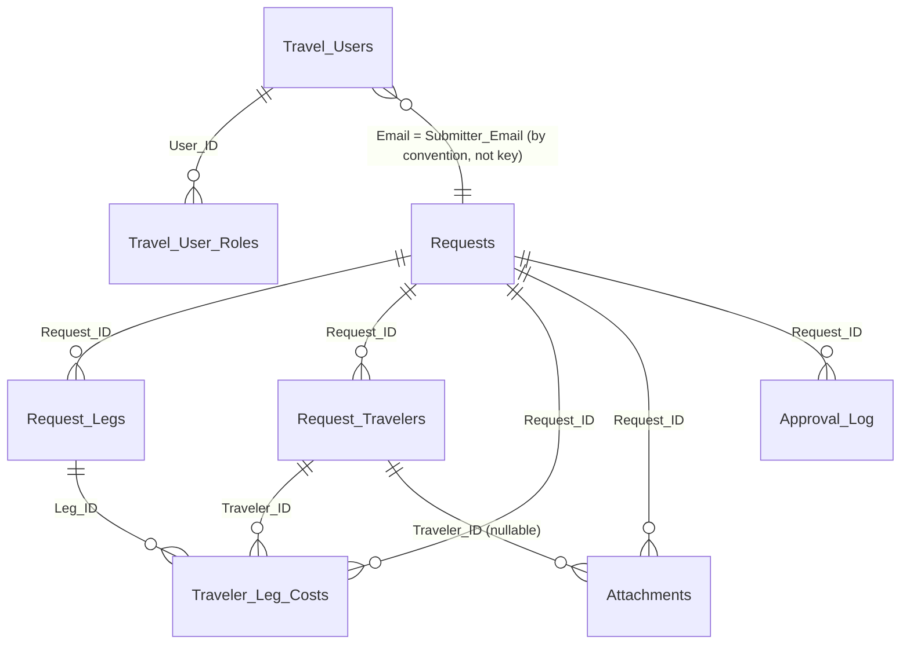

# LETS Data Layer — Pass 3

| Field | Value |
|---|---|
| **Title** | LETS Data Layer (Pass 3) |
| **Purpose** | Identify every spreadsheet, tab, and column the code reads or writes; record whether each is accessed by header name or by column position; and flag every place where column ORDER is load-bearing. Establishes the factual base for `DATA_DICTIONARY.md`. |
| **Date generated** | 2026-10-27 |
| **Prerequisite reading** | [FILE_MANIFEST.md](./FILE_MANIFEST.md), [ENTRY_POINTS_AND_ROUTING.md](./ENTRY_POINTS_AND_ROUTING.md) |

## Confidence summary

| Evidence class | Share | Scope |
|---|---|---|
| `[VERIFIED]` | ~85% | Every schema array, every `getSheetByName` target, every `readSheet`/`appendRow`/`setValues` call site, and every positional index was read in code. Column counts and write-array element counts were computed by parsing the source, not by eye. |
| `[INFERRED]` | ~5% | Consequences of mismatches, and intent behind unfinished structures. Each is stated with its reasoning. Where a consequence was important enough to prove, I executed the code instead of inferring — see Finding D-7. |
| `[CLAIMED]` | ~2% | Schema statements in documentation that code does not support. |
| `[UNKNOWN]` | ~8% | **The actual contents of every spreadsheet.** I can state what the code expects. I cannot state what row 1 of any live tab says, which tabs exist, or whether columns have drifted. Every such question is a verification task. |

**The single most important caveat.** This document describes the schema **as the code defines it**. A Google Sheet has no schema enforcement — the live sheets may have extra columns, missing columns, reordered columns, or renamed headers, and the code would partly work and partly fail silently. Reconciling code-expectation against sheet-reality requires opening the sheets. See §3.9.

---

## 3.1 How many databases are there?

**One spreadsheet does almost everything, and the code never names it.** `[VERIFIED]`

Every data access resolves to a single spreadsheet ID held in the Script Property `TRAVEL_DB_SPREADSHEET_ID`, read once at file-load time into a top-level constant:

```javascript
const TRAVEL_DB_SPREADSHEET_ID = _readScriptProperty('TRAVEL_DB_SPREADSHEET_ID');
```
`[VERIFIED]` `lets_app/server/00_config/TripConfig.js:151`

That constant appears in 29 `SpreadsheetApp.openById()` call sites. `[VERIFIED]` There is no fallback and no default — if the property is unset the constant is `null` and every data operation throws. The file header states this is deliberate: "the property MUST be set in Project Settings → Script Properties before deploy."

| Spreadsheet | How addressed | Role | Contents |
|---|---|---|---|
| **The travel database** | Script Property `TRAVEL_DB_SPREADSHEET_ID` | System of record — all requests, travelers, costs, users, roles, audit, per-diem reference data | `[UNKNOWN]` |
| **The FAS Travel Exception Tracker** | Script Property `FAS_TRACKER_SPREADSHEET_ID` (prod) or `TEST_FAS_TRACKER_SPREADSHEET_ID` (dev), resolved through the environment gate | **External** — owned by the FAS front office, write target only | `[UNKNOWN]` |
| Report exports | Created on demand via `SpreadsheetApp.create` | Transient output | n/a |
| Temp per-diem parse file | `Drive.Files.copy` of a downloaded `.xls`, then `openById` | Transient, deleted after parse `ForeignSync.js:306` | n/a |

**`PROJECT_PLAN.md:35` and the handoff doc both name `1kXB7eVII_EOlZEHSd-4vl3psTJZv57JvnrplhD2FA9Y` as the "Parent Container."** `[CLAIMED]` No code references that ID. Whether the Script Property points at it is `[UNKNOWN]` and is verification task V-5. The distinction matters: a *container-bound* script and a script that merely opens a sheet by ID behave differently for permissions and backup. All access here is by-ID, which means **the database need not be the bound sheet at all** — and a misconfigured property would silently point production at the wrong spreadsheet.

---

## 3.2 Layer A — the TRIP data layer (this is what runs)

### 3.2.1 Declared tabs vs. tabs with a schema vs. tabs actually used

`SHEET_NAMES` declares 16 tab names `[VERIFIED]` `01_constants/Sheets.js:21-45`. `TRAVEL_SHEET_SCHEMAS` defines column headers for only 10 of them `[VERIFIED]` `:54-288`. The gap matters because `setupTravelDatabase()` iterates `TRAVEL_SHEET_SCHEMAS`, not `SHEET_NAMES` — so the six schema-less tabs are **never created by the initializer**.

| Tab name (exact) | In `SHEET_NAMES` | Has schema | Code references | Created by | Status |
|---|---|---|---|---|---|
| `Requests` | yes | yes (42 cols) | 72 | `setupTravelDatabase` | **Core, active** |
| `Request_Legs` | yes | yes (15) | 11 | `setupTravelDatabase` | Core, active |
| `Request_Travelers` | yes | yes (38) | 30 | `setupTravelDatabase` | Core, active |
| `Traveler_Leg_Costs` | yes | yes (31) | 11 | `setupTravelDatabase` | Core, active |
| `Attachments` | yes | yes (11) | 3 | `setupTravelDatabase` | Active |
| `Approval_Log` | yes | yes (14) | 44 | `setupTravelDatabase` | **Core, active — the audit trail** |
| `Travel_Users` | yes | yes (9) | 20 | `setupTravelDatabase` + `addUnifiedUserSchema` | **Core, active — identity** |
| `Travel_User_Roles` | yes | yes (11) | 29 | `setupTravelDatabase` + `addUnifiedUserSchema` | **Core, active — authorization** |
| `Test_Submitters` | yes | yes (6) | 6 | `setupTravelDatabase` | Active fallback for non-HC users |
| `Error_Log` | yes | yes (6) | 2 | auto-created by `logError` `Errors.js:50-58` | Active |
| `Feedback` | yes | **NO** | 6 | **nothing** | **Active but uncreated — see Finding D-1** |
| `DoD_Per_Diem` | yes | **NO** | 0 via `SHEET_NAMES` | auto-created by `getDoDPerDiemSheet_` `DoDSync.js:155-167` | Active via a **separate duplicate constant** |
| `DoD_Sync_Log` | yes | **NO** | 0 via `SHEET_NAMES` | auto-created `DoDSync.js:182-190` | Active via duplicate constant |
| `Foreign_Per_Diem` | yes | **NO** | 0 via `SHEET_NAMES` | auto-created `ForeignSync.js:485-503` | Active via duplicate constant |
| `DOS_Sync_Tracker` | yes | **NO** | 0 via `SHEET_NAMES` | auto-created `ForeignSync.js:586-588` | Active via duplicate constant |
| `File_Queue` | yes | **NO** | **0 anywhere** | nothing | **Phantom — see Finding D-2** |

### Finding D-1 — the `Feedback` tab is used but never created

`submitTravelFeedback` writes 13 values to `Feedback` `[VERIFIED]` `Feedback.js:53-69`, and `getRecentFeedback` reads it back by header name `:270-301`. But `Feedback` has **no entry in `TRAVEL_SHEET_SCHEMAS`** `[VERIFIED]`, so:

- `setupTravelDatabase()` does not create it.
- Nothing else creates it either — unlike `Error_Log` and the four per-diem tabs, which self-create on first use.
- `submitTravelFeedback` checks for it and returns `errorResponse('Feedback sheet not found')` if absent `Feedback.js:45-47`. The user sees a failure; no data is lost but no feedback is captured.

**The column headers exist nowhere in code.** The writer writes 13 positional values; the reader resolves `headers.indexOf('User_Email')`, `'Feedback_Type'`, `'Timestamp')` `Feedback.js:145-147`, and `getRecentFeedback` builds objects keyed by raw header text `:297-303`. The admin UI then reads `.Feedback_ID`, `.Feedback_Type`, `.User_Email`, `.User_Name`, `.Timestamp`, `.Context_Page`, `.Context_Action`, `.Request_ID`, `.NPS_Score`, `.Comment`, `.Category`, `.Browser_Info`, `.Page_URL` `[VERIFIED]` `travelAdminController.html`.

So the required header row is **reconstructable only by cross-referencing the writer's positional order against the client's field names**, which is how I derived it:

| # | Required header | Writer source `Feedback.js` |
|---|---|---|
| 1 | `Feedback_ID` | `feedbackId` (`fb_<ts>_<rand>`) |
| 2 | `Timestamp` | `new Date()` |
| 3 | `User_Email` | `Session.getActiveUser().getEmail()` |
| 4 | `User_Name` | `feedbackData.userName` |
| 5 | `Feedback_Type` | `feedbackData.type` — incl. literal `'nps_dismiss'` from `dismissNpsPrompt:212` |
| 6 | `Context_Page` | `feedbackData.contextPage` |
| 7 | `Context_Action` | `feedbackData.contextAction` |
| 8 | `Request_ID` | `feedbackData.requestId` |
| 9 | `NPS_Score` | numeric, only when `type === 'nps'` |
| 10 | `Comment` | `feedbackData.comment` |
| 11 | `Category` | `feedbackData.category` |
| 12 | `Browser_Info` | `feedbackData.browserInfo` |
| 13 | `Page_URL` | `feedbackData.pageUrl` |

`[INFERRED]` — the *order* is `[VERIFIED]` from the writer; the *names* are `[VERIFIED]` from the reader and client; the pairing of name to position is the inference. **Recommended fix:** add this array to `TRAVEL_SHEET_SCHEMAS` so the tab is created and documented in one place. Until then, if anyone recreates the database, feedback silently stops working.

### Finding D-2 — `File_Queue` is a phantom tab

`SHEET_NAMES.FILE_QUEUE = 'File_Queue'` `[VERIFIED]` `Sheets.js:38`. That line is the **only** occurrence of the identifier or the string in the entire codebase `[VERIFIED]`. No schema, no reader, no writer, no creator.

**Speculation on intent.** `[INFERRED]` The name and its placement under the `// Operational` comment alongside `Error_Log` and `Feedback` suggest a planned asynchronous file-processing queue — most plausibly to decouple Drive uploads from the submission request, which currently happen inline in `finalizeRequestAttachments` `Attachments.js:238` and are the slowest part of submission. If a live `File_Queue` tab exists with data in it, something outside this repository wrote it. If it does not exist, nothing breaks. Either way it is dead weight in the registry and should be either implemented or deleted.

### Finding D-3 — four tabs are addressed through duplicate constants, bypassing the registry

`Sheets.js` presents itself as "the single source of truth for what sheets exist," and `_checkSheetNamesAdoption()` `CacheWarming.js:289` exists to verify every `SHEET_NAMES` entry resolves to a real tab. But the four per-diem tabs are reached through **their own separate constants** in the per-diem files, not through `SHEET_NAMES`:

| Tab | Registry entry | Duplicate constant actually used | Files |
|---|---|---|---|
| `DoD_Per_Diem` | `SHEET_NAMES.DOD_PER_DIEM` (0 uses) | `DOD_PERDIEM_SHEET_NAME` `DoDSync.js:26` **and** `DOD_SHEET_NAME` `PerDiemDoD.js:18` | 2 independent constants for 1 tab |
| `DoD_Sync_Log` | `SHEET_NAMES.DOD_SYNC_LOG` (0 uses) | `DOD_SYNC_LOG_SHEET_NAME` `DoDSync.js` | — |
| `Foreign_Per_Diem` | `SHEET_NAMES.FOREIGN_PER_DIEM` (0 uses) | `DOS_PERDIEM_SHEET_NAME` `ForeignSync.js:19` **and** `FOREIGN_PERDIEM_SHEET_NAME` `PerDiemForeign.js:18` | 2 constants, 1 tab |
| `DOS_Sync_Tracker` | `SHEET_NAMES.DOS_SYNC_TRACKER` (0 uses) | `DOS_SYNC_TRACKER_SHEET` `ForeignSync.js:20` | — |

**Consequence:** renaming a per-diem tab via `SHEET_NAMES` — exactly what the registry's own header comment promises will work ("a sheet rename happens in exactly one place") — would change nothing, while the four duplicate constants kept the old name. Worse, the writer and the reader of the same tab use *different* constants that happen to hold the same string. Changing one and not the other produces a sync that writes to a tab nobody reads. This is a trap for the next developer and should be collapsed to the registry.

---

## 3.3 Access mode: header-name vs. column-position

This is the section that determines whether an administrator may safely reorder columns in the Sheets UI. **The answer is no.** The reasons are specific and worth understanding.

### 3.3.1 The dominant pattern is safe

`TravelDB.readSheet(name)` reads the whole tab and builds a header→index map:

```javascript
var headers = all[0];
var headerIndex = {};
for (var i = 0; i < headers.length; i++) headerIndex[headers[i]] = i;
return { headers: headers, rows: all.slice(1), headerIndex: headerIndex };
```
`[VERIFIED]` `20_data/TravelDB.js:117-121`

Callers then index by name — `row[reqIdx['Status']]`. There are **263 `headerIndex` usages across 19 files** `[VERIFIED]`. `TravelDB.updateRowByIndex` is also header-driven and **throws** on an unknown column rather than writing to the wrong place `TravelDB.js:216-218` — good defensive behavior.

So **reordering columns would not break the majority of reads.** What breaks is narrower and more dangerous: a handful of writes and reads that assume position.

### 3.3.2 Where column ORDER is load-bearing — the complete list

| # | Location | Mechanism | Order dependency | Failure mode if violated |
|---|---|---|---|---|
| **1** | `Submission.js:291-340` | Builds a **42-element positional array** and `appendRow`s it to `Requests` | **Absolute.** Element *n* must be column *n*. Verified: 42 elements vs 42 schema columns — currently correct. | Every new request writes **every field into the wrong column**. Silent. Catastrophic. |
| **2** | `Submission.js:376-394` | 15-element positional array → `Request_Legs` via `setValues` | Absolute. 15 vs 15 — correct. | All itinerary data shifted |
| **3** | `Submission.js:456-492` | **36**-element positional array → `Request_Travelers` (schema has 38) | Absolute for cols 1–36; cols 37–38 (`DD_Confirmed`, `DD_Confirmed_At`) intentionally left blank at submission and written later | All traveler + cost data shifted |
| **4** | `Submission.js:509-575` | 31-element positional array → `Traveler_Leg_Costs` | Absolute. 31 vs 31 — correct. | All per-leg cost data shifted |
| **5** | `Submission.js:602-617` | 14-element positional array → `Approval_Log` | Absolute. 14 vs 14 — correct. | Audit entries corrupted |
| **6** | `Attachments.js:327-340`, `:397-410` | 11-element positional arrays → `Attachments` | Absolute. 11 vs 11 — correct. | File metadata shifted |
| **7** | `Errors.js:60-67` | 6-element positional array → `Error_Log` | Absolute. 6 vs 6 — correct. | Error log corrupted |
| **8** | `Feedback.js:53-69`, `:211-225` | 13-element positional arrays → `Feedback` | Absolute, **and the schema is undocumented** (Finding D-1) | Feedback data shifted |
| **9** | `Review_Action.js:64`, `:475`, `:593`; `Review_Read.js:81` | Reads `rows[i][0]` as `Request_ID` | **Assumes `Request_ID` is column A** | Request lookup silently finds nothing → "Request not found" |
| **10** | `Database.js:505`, `:530` | ID generators read column A only: `getRange(2, 1, lastRow-1, 1)` | Assumes `Request_ID` / `Log_ID` in column A | ID sequence resets to 1 → **duplicate primary keys** |
| **11** | `Feedback.js:272` | `row[0]` as the "has a Feedback_ID" test | Assumes column A | Rows filtered out |
| **12** | `Submission.js:585-595` | `TRAVEL_SHEET_SCHEMAS.Requests.indexOf('Traveler_Total')`, then **asserts adjacency** with `Grand_Total` before a 2-wide `setValues` | Soft — **has a correct fallback** to two single writes if not adjacent | None. This is the right pattern. |
| **13** | `Review_DDConfirm.js:311-337` | Resolves `DD_Confirmed` / `DD_Confirmed_At` by header, checks adjacency, 2-wide write with fallback | Soft — correct fallback | None |
| **14** | `Review_DDConfirm.js:359-369` | Resolves `Status` / `Updated_At` by header, checks adjacency, fallback | Soft — **and the assumption is already false**: `Status` is col 2, `Updated_At` is col 40. The fallback branch is what actually executes. | None, but the "optimization" is dead code |
| **15** | `PerDiemDoD.js:22-31` + `:605-623` | `DOD_PERDIEM_COL` maps names to fixed indices 0–8; reads `row[0]`…`row[5]` | **Absolute**, against a tab written by `DoDSync.js` | Rates read from wrong columns → **wrong per-diem figures in cost estimates** |
| **16** | `PerDiemForeign.js:22-34` + `:721-739` | `FPD_COL` maps names to fixed indices 0–10 | **Absolute** | Wrong foreign rates |
| **17** | `ForeignSync.js:627-630` | `data[i][0..3]` on `DOS_Sync_Tracker` | Absolute | Sync-state misread → re-sync or skipped sync |
| **18** | **`FASTrackerSync.js:148-163`, `:233-239`** | Writes a 14-element positional array to **another organisation's spreadsheet**; reads status from **column M** (`row[12]`) | **Absolute, and outside this project's control** | Rows written into wrong FAS columns; decisions misread |

**The summary for a non-programmer.** The code reads flexibly but writes rigidly. Inserting a column into `Requests`, `Request_Legs`, `Request_Travelers`, `Traveler_Leg_Costs`, `Approval_Log`, `Attachments`, `Error_Log`, or `Feedback` **will not cause an error message**. It will cause every subsequent new record to have its values written one column to the left or right of where they belong, producing a database where names appear in date fields and dollar amounts appear in comment fields. Existing rows stay correct, so the damage is invisible until someone notices new records look wrong.

**Rule to put in the Administrator's Guide:** never insert, delete, reorder, or rename a column in any tab. Add new columns **only at the far right end**, and only after the code that writes the tab has been updated in the same change.

### 3.3.3 One place the code adds columns to itself at runtime

`reportDDFundingIssue` appends three columns to `Requests` **if they are missing**, writing the header into the next free column and then writing data under it:

```javascript
let flaggedCol = idx['DD_Flagged_Travelers'];
if (flaggedCol === undefined) {
  const lastCol = headers.length + 1;
  requestsSheet.getRange(1, lastCol).setValue('DD_Flagged_Travelers');
  flaggedCol = lastCol - 1;
}
```
`[VERIFIED]` `Review_DDConfirm.js:509-534` — same pattern for `DD_Issue_Notes` and `DD_Issue_Reporter`.

**None of the three appear in `TRAVEL_SHEET_SCHEMAS.Requests`.** `[NOT FOUND]` Consequences worth flagging:

- The live `Requests` tab will have **45 columns**, not 42, as soon as any Division Director reports a funding issue. A reader comparing the sheet to the schema will think three columns are undocumented extras. They are undocumented, but they are real and load-bearing.
- A subsequent `setupTravelDatabase()` run writes only the 42 schema headers, leaving columns 43–45 with their headers intact (it writes a 42-wide range, so it does not clear them). Benign — but `createOrUpdateSheet` would be destructive if the schema ever shrank.
- **There is a latent bug.** The first of the three uses `headers.length + 1` while the other two use `requestsSheet.getLastColumn() + 1` `[VERIFIED]` `:511` vs `:521,529`. These differ when the sheet has trailing columns beyond the cached header array. In the common path they agree; in a sheet with extra columns the first could overwrite an existing column's header. Inconsistent and worth normalising.

---

## 3.4 Keys, relationships, and what the code actually enforces

### 3.4.1 Primary keys and their formats

| Tab | Primary key | Format | Generator | Collision safety |
|---|---|---|---|---|
| `Requests` | `Request_ID` | `REQ-<calendar year>-<4 digits>` | `generateRequestId()` `Database.js:493` | **None — see D-4** |
| `Request_Legs` | `Leg_ID` (unique within request) | `leg_<epoch ms>_<index>` or client-supplied | `Submission.js:379` | Timestamp+index |
| `Request_Travelers` | `Traveler_ID` | `traveler_<epoch ms>_<index>` or client-supplied | `Submission.js:458` | Timestamp+index |
| `Traveler_Leg_Costs` | composite (`Request_ID`,`Traveler_ID`,`Leg_ID`) | — | — | n/a |
| `Approval_Log` | `Log_ID` | `LOG-<6 digits>` **or** a UUID | **Two different generators — see D-5** | None for the `LOG-` form |
| `Attachments` | `Attachment_ID` | `att_<epoch ms>_<6 rand chars>` | `Attachments.js:325,395` | Random suffix — safe |
| `Travel_Users` | `User_ID` | HC `employee_id`, else `ext_<token>` | HC lookup or admin-supplied | Admin-enforced |
| `Travel_User_Roles` | `Role_ID` | `role_<12 hex>` = digest of (`User_ID`,`Role_Type`,`Scope`) | `_generateBootstrapRoleId` `Database.js:385` | **Deterministic — idempotent by design** |
| `Feedback` | `Feedback_ID` | `fb_<epoch ms>_<6 rand>` | `Feedback.js:49` | Random suffix — safe |
| `Error_Log` | *(none)* | — | — | append-only |
| `Test_Submitters` | `Email` | — | manual | — |

### Finding D-4 — `Request_ID` generation can collide under concurrency

`generateRequestId()` reads column A of `Requests`, finds the highest `REQ-<year>-NNNN`, and returns max+1 `[VERIFIED]` `Database.js:493-516`. There is **no lock**. Two submissions in the same moment both read the same max and both produce the same ID.

`LockService` **is** used elsewhere in this codebase — `Users.js:1512` and `:1709` take a script lock for bulk role reassignment `[VERIFIED]` — so the mechanism is available and understood. It is simply not applied to ID generation or to the submission write path. The code says so itself: *"NO LockService — BUGS_FOUND #7 (multi-sheet atomicity gap). Separate ticket post-refactor, intentionally not bundled here."* `[VERIFIED]` `Submission.js:211-212`.

**This is a known, deliberately deferred defect, not an oversight.** Two consequences compound it:

1. A duplicate `Request_ID` makes `Review_Action.js:64`'s `rows[i][0] === requestId` match the **first** row only. Approving one request would operate on another request's row. Nothing detects it.
2. `submitTravelRequestV2` writes to **five tabs without a transaction** `[VERIFIED]` `Submission.js:342,398,498,573,618`. A failure partway through leaves a request with, say, legs but no travelers. There is no rollback and no reconciliation job.

The referenced tracking document **`BUGS_FOUND.md` does not exist** — not in the working tree and not in any commit `[NOT FOUND]`. Same for `Data_Model_v2.md` (cited by `Sheets.js:52` as the schema's source of truth), `OPEN_QUESTIONS.md` (cited 3×), and `REFACTOR_PLAN.md` (cited 2×). **Four referenced design documents, zero present.** The code's own cross-references point into a void, which is itself a significant handoff finding: whoever wrote this code was working from a document set that never entered version control.

### Finding D-5 — two incompatible `Log_ID` formats in one tab

`Approval_Log.Log_ID` is generated two different ways depending on the code path `[VERIFIED]`:

| Path | Generator | Format |
|---|---|---|
| `Submission.js:601`, `Review_Action.js:155`, `Review_Update.js` (4 sites) | `generateLogId()` `Database.js:522` | `LOG-000123` — sequential, derived from max existing |
| `Admin_Actions.js:69,143`, `Users.js:1603,1768` | `Utilities.getUuid()` | `a1b2c3d4-…` — random UUID |

Both land in the same column. `generateLogId()` scans for the prefix `'LOG-'` and ignores UUIDs `Database.js:531`, so the sequence is unaffected — but the tab now holds two key vocabularies. Anything that sorts by `Log_ID`, parses it, or assumes a format will mishandle half the rows. Not data-destroying; definitely an inconsistency a developer must know about before writing a report over the audit log.

### 3.4.2 Foreign keys and referential rules



**What the code enforces, and what it does not:** `[VERIFIED]`

| Rule | Enforced? | Evidence |
|---|---|---|
| Child rows carry `Request_ID` | Yes, at write time | All four child writers put `requestId` in column 1 |
| Cascading delete across children | **Yes** — the only referential integrity in the system | `deleteTravelRequests` `Admin_Cleanup.js:128` deletes across 6 tabs, children first, indices descending |
| Orphan prevention on partial failure | **No** | No transaction; 5 separate writes `Submission.js` |
| `Travel_User_Roles.User_ID` must exist in `Travel_Users` | **At read time only** — the join skips roles whose user is missing or inactive `Access.js:267-268` | A role row pointing at a deleted user is silently ignored, not reported |
| `Role_Type` restricted to a known set | **Yes, on write** — `TRAVEL_ROLE_TYPES` of 6 values, validated `Users.js:279,713` | Direct sheet edits bypass this entirely |
| `Scope` required for scoped roles | **Yes, on write** — `bu_reviewer` and `sector_override` require it `Users.js:287,721` | Same bypass |
| One primary `aas_fo_reviewer` | **Yes** — adding a primary demotes the incumbent `Users.js:306-323` | Same bypass |
| `Submitter_Email` must be a known user | **No** | Free text from the session |
| Status values restricted to `STATUS_CODES` | **No column-level constraint**; transitions are validated in `getActionConfig` `Review_Action.js:303` | Direct sheet edit can set any string |
| **Any data validation dropdowns on the sheets** | **None created by code** `[VERIFIED]` — zero `newDataValidation` calls | Whether they exist manually is `[UNKNOWN]` |
| **Any named ranges** | **None** | `[VERIFIED]` — zero `getRangeByName` |
| **Any sheet protections** | **None created by code** | The only `addEditor` call grants a report requester edit on a *new export* file `Reporting.js:319` |

The absence of data validation, named ranges, and protections means **the sheet has no defences of its own.** Everything depends on the application being the only writer, which §2.5 established is not the case.

---

## 3.5 Layer B — the LETS data layer (defined, seeded, never read)

Seven tabs, declared in `LETS_CONFIG.sheets` `[VERIFIED]` `00_config/BudgetConfig.js:122-130` with headers in `LetsDB.SCHEMAS` `20_data/LetsDB.js:41-133`.

| Tab name (exact) | Columns | Created by | Seeded by | **Read by** | **Written by** |
|---|---|---|---|---|---|
| `Budgets` | 12 | `LetsDB.initializeDatabase` | yes — 4 rows from `CONFIG.baselineAllocations` | **nothing** | **nothing** |
| `Budget_Adjustments` | 7 | same | no | **nothing** | **nothing** |
| `Set_Asides` | 7 | same | yes — 5 rows from `CONFIG.defaultSetAsides` | **nothing** | **nothing** |
| `Org_Approvers` | 8 | same | yes — 4 rows from `CONFIG.defaultApprovers` | **nothing** | **nothing** |
| **`Requests`** | **20** | same | no | **nothing** | **nothing** |
| `Travelers` | 16 | same | no | **nothing** | **nothing** |
| `Audit_Log` | 7 | same | no | **nothing** | **nothing** |

**`initializeDatabase()` is itself never called.** `[VERIFIED]` — the identifier appears only at its definition `LetsDB.js:160` and in the module's export list `:233`. So none of these seven tabs is created by any reachable code path either.

### Finding D-6 — the `Requests` tab-name collision, in full

Both layers declare a tab named exactly `Requests`, with incompatible schemas.

| | Layer A (TRIP) | Layer B (LETS) |
|---|---|---|
| Declared at | `Sheets.js:23` → `TRAVEL_SHEET_SCHEMAS.Requests` `:57-100` | `BudgetConfig.js:127` → `LetsDB.SCHEMAS['Requests']` `LetsDB.js:84-105` |
| Columns | 42 | 20 |
| Column 1 | `Request_ID` | `RequestID` |
| Column 2 | `Status` | `Status` ← **the only shared header** |
| Column 3 | `Trip_Name` | `EventName` |
| ID format | `REQ-2026-0001` | `LETS-2027-001` |
| Status vocabulary | `PENDING_SECTOR`, `APPROVED_GOGOV`, `COMPLETED`, … (15 values, mostly ALL_CAPS) | `Submitted - Pending Budget Check`, `Flagged - Insufficient Funds`, `Reconciled / Actuals Posted`, … (12 values, prose with spaces and slashes) |
| Naming convention | `Snake_Case_With_Underscores` | `PascalCaseNoSeparator` |

**What happens if both run against the same spreadsheet.** `[INFERRED]` — reasoning given so it can be checked:

`LetsDB.initializeDatabase()` creates a tab only if absent, then writes headers only if `sheet.getLastRow() === 0` `[VERIFIED]` `LetsDB.js:164-173`. Against a live TRIP database:

- The `Requests` tab exists and has rows, so `getLastRow()` ≠ 0 → **headers are not overwritten.** The TRIP schema survives.
- But the tab is then treated by LETS code as if it had LETS's 20 columns. Reads by header name (`RequestID`, `EventName`, `OwningOffice`, …) find nothing and return `undefined`.
- Seeding is skipped for `Requests` (no seed block), so no junk rows are written.

So the realistic outcome is **not** corruption — it is **silent total failure**: LETS budget reads return `undefined` for every field. Which brings us to the quieter and more serious problem.

### Finding D-7 — even in isolation, Layer B cannot read its own tabs

This is the finding I consider most consequential in Pass 3, because it means "wire up the budget engine" is a larger job than it appears.

`LetsDB.sheetDataToObjects(sheet)` keys each row object by **raw header text** `[VERIFIED]` `LetsDB.js:149-151`:
```javascript
headers.forEach((h, colIdx) => { obj[h] = row[colIdx]; });
```
So reading the `Budgets` tab yields objects with keys `OfficeCode`, `OfficeName`, `BaselineAllocation`, …

But `BudgetEngine` reads **camelCase property names** `[VERIFIED]` — extracted from the source:

| Tab | Header the sheet would have | Property `BudgetEngine` reads | Code |
|---|---|---|---|
| `Budgets` | `OfficeName` | `office.name` | `BudgetEngine.js:216` |
| `Budgets` | `BaselineAllocation` | `office.baselineAmount` | `:195, 217` |
| `Budgets` | `ProportionalShare` | *not read from the sheet at all* — taken from `CONFIG.baselineAllocations[code].standardProportionalShare` | `:69-70` |
| `Budget_Adjustments` | `OfficeCode` | `adj.officeCode` | `:44` |
| `Budget_Adjustments` | `Amount` | `adj.amount` | `:45` |
| `Set_Asides` | `SetAsideID` | `item.id` | `:96` |
| `Set_Asides` | `Title` | `item.title` | `:97` |
| `Set_Asides` | `Type` | `item.type` | `:93` |
| `Set_Asides` | `TargetOffice` | `item.targetOffice` | `:93` |
| `Set_Asides` | `Amount` | `item.amount` | `:92` |
| `Requests` (LETS) | `OwningOffice` | `req.owningOffice` | `:150` |
| `Requests` (LETS) | `Status` | `req.status` | `:155` |
| `Requests` (LETS) | `TotalEstimatedCost` | `req.totalEstimatedCost` | `:152` |
| `Requests` (LETS) | `TotalActualCost` | `req.totalActualCost` | `:153` |
| `Travelers` | `EstAirfare` / `ActAirfare` (etc.) | `t.estAirfare` / `t.actAirfare` | `:272-279` |

**Every pairing is a mismatch.** JavaScript property access on a missing key returns `undefined`, and the engine's coercions are `Number(x) || 0` `[VERIFIED]` `:42,45,92,152-153`, `(x) || 0`, `|| ''`. So the failure mode is **not an exception — it is zeros.**

**I confirmed this by execution rather than inference.** `[VERIFIED]` I built the exact objects `LetsDB.sheetDataToObjects()` would return for the `Budgets` and `Set_Asides` tabs (keys = raw header text), keyed them by `OfficeCode` as any repository layer would, and called the engine directly under Node:

```
--- OMD summary, fed sheet-shaped rows ---
officeName                   : undefined
baselineAllocation           : 0
totalAllocation              : 0
setAsides.totalSetAsides     : 0
discretionaryBase            : 0
remainingDiscretionaryBalance: 0
isDeficit                    : false

--- portfolio ---
totalBaseline        : 0
totalSetAsides       : 0
totalRemainingBalance: 0

--- gatekeeper on a $2,500 request ---
hasSufficientFunds : false
message            : INSUFFICIENT FUNDS: Requested $2,500 exceeds available
                     discretionary balance of $0 (Projected deficit: -$2,500).
```

So the behavior is not merely predicted, it is demonstrated: **every office reports a $0 budget, and the gatekeeper rejects every request as unfunded** — including a $2,500 request against an office that actually holds $136,940. Note `isDeficit` reports `false` while the balance is $0, so no alarm is raised anywhere. A developer would see a dashboard full of zeros, a blanket "insufficient funds" on every submission, and **no error message to chase.**

**Why the tests pass anyway.** `test_budget_engine.js` and `test_gas_module_load.js` feed the engine objects taken **directly from `LETS_CONFIG`** — which uses camelCase (`code`, `name`, `baselineAmount`, `standardProportionalShare`) `[VERIFIED]` `BudgetConfig.js:12-39`. They never go through `sheetDataToObjects`. So all three suites pass (I ran them) while the sheet-to-engine path is untested and broken. **This is exactly the blind spot the project's own `test_gas_module_load.js` header warns about** for a different bug — the same lesson applies here and has not been applied.

**Speculation on intent, and the fix.** `[INFERRED]` The two naming schemes tell the story: `LETS_CONFIG` and `BudgetEngine` were written together as a pure-JavaScript, test-driven unit (camelCase throughout), while `LetsDB.SCHEMAS` was written as spreadsheet headers for human readability (PascalCase). The mapping layer between them was the next step and was never written. The fix belongs in exactly one place — a field-mapping function inside the missing `loadLetsState()` from Pass 2 Finding R-5:

```javascript
// Illustrative. Does not exist. [NOT FOUND]
function mapBudgetRow(r) {
  return { code: r.OfficeCode, name: r.OfficeName,
           baselineAmount: Number(r.BaselineAllocation) || 0,
           standardProportionalShare: Number(r.ProportionalShare) || 0 };
}
```
Doing it in the repository layer, not by renaming headers, keeps the sheets human-readable and leaves the tested engine untouched. **A regression test that round-trips through `sheetDataToObjects` should land in the same change** — otherwise the next person hits the same silent-zeros trap.

### Finding D-8 — three Layer B tabs have a schema and no writer even in intent

`Travelers` (16 cols) and `Audit_Log` (7 cols) have schemas, no seed, no reader, **and no writer anywhere, even among unwired code** `[VERIFIED]`.

`RequestService` *produces* the data they are shaped for but never persists it: `createTravelRequest` returns `{request, travelers, budgetCheck, assignedApprover}` `RequestService.js:111-116` and `updateRequestStatus` returns `{request, auditEntry}` `:174-177`. The `auditEntry` object's fields — `logId`, `timestamp`, `actorEmail`, `actionType`, `targetEntity`, `entityId`, `detailsJSON` `:160-172` — map **exactly** onto `Audit_Log`'s 7 columns `LetsDB.js:124-132`. Likewise the traveler objects map onto `Travelers`.

So the persistence contract was fully designed; only the function that writes it is missing. **For scoping: the `Audit_Log` mapping is 1:1 camelCase→PascalCase and is the single easiest piece of this layer to finish.** Note also that `RequestService` mutates request objects **in place** (`request.status = newStatus` `:157`) and returns them, assuming the caller re-persists — a repository layer must therefore write back, not just append.

---

## 3.6 Layer C — the external FAS tracker, as the code expects it

This is **not our spreadsheet.** The structure below is inferred entirely from how the code reads and writes it. `[INFERRED]` from `[VERIFIED]` code; the real sheet is `[UNKNOWN]`.

Tab name: `'FAS Travel Exceptions'`, with a **silent fallback to the first sheet** if that name is absent `[VERIFIED]` `FASTrackerSync.js:25,93`. The fallback is dangerous: a renamed tab means writes land in whatever sheet happens to be first.

| Col | Position | Content written | Source field | Sensitivity |
|---|---|---|---|---|
| A | 1 | LETS Request ID | `request.requestId` | — |
| B | 2 | Timestamp `MM/dd/yyyy HH:mm:ss` America/New_York | `new Date()` | — |
| C | 3 | Requester name | `submitterName \|\| requesterName` | **PII** |
| D | 4 | Portfolio / owning office | `owningOffice` | — |
| E | 5 | Purpose of travel | `travelPurposeLabel \|\| purpose` | CUI |
| F | 6 | Event / trip title | `eventName \|\| tripName` | — |
| G | 7 | Destination | `destination` | — |
| H | 8 | Start date | `startDate` | — |
| I | 9 | End date | `endDate` | — |
| J | 10 | Estimated cost | `Number(totalEstimatedCost)` | **Financial** |
| K | 11 | Brief written justification | `roleJustification \|\| justification` | **CUI — pre-decisional** |
| L | 12 | Salesforce Event Tracker ID | `eventTrackerId` | — |
| M | 13 | **Official approval status** | literal `'Pending FAS CoS Approval'` on write; **read back** for decisions | — |
| N | 14 | Submitter email | `Session.getActiveUser().getEmail()` | **PII** |

`updateFASTrackerRow` writes only columns **12** and **10**, by hardcoded number `[VERIFIED]` `:205,208`.

**Brittle integration points, ranked:**

1. **Substring status matching.** `normalizedStatus.indexOf('approved') !== -1` `[VERIFIED]` `:245`. A FAS value of **"Not Approved"**, **"Unapproved"**, or **"Pre-approved"** all contain "approved" and would be read as an approval. `isApproved` is then set by the same test `:250`. **This should be an exact-match allowlist before any production use.**
2. **Positional writes into a foreign schema.** If FAS inserts a column, every field lands one position off — into *their* system of record, where it cannot be cleanly retracted. The module's own header acknowledges this: *"Appending test data is an uncorrectable write to another organization's system of record."*
3. **Fixed read width.** `getRange(2, 1, lastRow-1, 13)` `:233` assumes at least 13 columns. Fewer → throws. More → silently ignored.
4. **Tab-name fallback** to `getSheets()[0]`.

**Credit where due:** the environment gate protecting this is genuinely well built. `resolveFASTrackerTarget` `TripConfig.js:108-177` fails closed in every direction — unset property disables the feature rather than falling back; a development environment whose test ID equals the production ID is **refused outright** with an explicit reason; anything other than the exact string `'production'` resolves to `development` `:63-67`. `test_fas_tracker_env.js` covers all six of those cases and passes. This is the strongest-engineered component in the repository.

---

## 3.7 Reference-data tabs (per-diem), and the status/enum vocabularies

### 3.7.1 Per-diem tabs — positional, written by sync, read by lookup

| Tab | Written by | Headers written | Read by | Read mode |
|---|---|---|---|---|
| `DoD_Per_Diem` | `DoDSync.js:161-165` | `Territory, Locality, Season Start, Season End, Lodging, MIE, Per Diem, Effective Date, Document Number` (9, **space-separated, not underscored**) | `PerDiemDoD.js` | `DOD_PERDIEM_COL` fixed indices 0–8 |
| `DoD_Sync_Log` | `DoDSync.js:186-188` | `Timestamp, Document Number, Territory, Rows Added, Status` (5) | nothing | append-only |
| `Foreign_Per_Diem` | `ForeignSync.js:497-501` | `Country, Location, Season Code, Season Start, Season End, Lodging, M&IE, Per Diem, Effective Date, Footnote, Location Code` (11) | `PerDiemForeign.js` | `FPD_COL` fixed indices 0–10 |
| `DOS_Sync_Tracker` | `ForeignSync.js:587` | `Sync Key, Synced At, Record Count, Source URL` (4) | `ForeignSync.js:627-630` | positional `data[i][0..3]` |

Note the header style breaks the convention used everywhere else — `Season Start` with a space, `M&IE` with an ampersand. Harmless given positional access, but it means these four tabs cannot be read by the header-name helpers used for the core tabs.

GSA CONUS rates are **not** stored in a tab — they come live from `https://api.gsa.gov/travel/perdiem/v2/rates` with CacheService caching `[VERIFIED]` `PerDiemGSA.js:16,49`, requiring Script Property `GSA_PERDIEM_API_KEY`.

### 3.7.2 Enumerated values — the exact strings

**Request status — Layer A (`STATUS_CODES`, the live vocabulary)** `[VERIFIED]` `01_constants/Status.js:8-36`:

`DRAFT`, `PENDING_SECTOR`, `PENDING_BU`, `PENDING_OSO`, `PENDING_FAS`, `Pending_DD_Confirmation`, `Pending_Correction`, `NEEDS_INFO_SECTOR`, `NEEDS_INFO_BU`, `NEEDS_INFO_OSO`, `APPROVED_GOGOV`, `COMPLETED`, `DENIED`, `CANCELLED`, `SUBMITTER_CANCELLED`

**Two of these break the casing convention on purpose.** `Pending_DD_Confirmation` and `Pending_Correction` are TitleCase while the rest are ALL_CAPS. The code documents why: *"Pre-existing inconsistency; documented Option A in REFACTOR_PLAN. Option C (normalize to ALL_CAPS with a one-shot data migration) is deferred — see OPEN_QUESTIONS.md Q1."* `[VERIFIED]` `Status.js:17-21`. Both referenced documents are absent `[NOT FOUND]`. **Anyone writing a status comparison must match these two exactly** — a `.toUpperCase()` normalisation would silently stop matching live data.

**Action types** `[VERIFIED]` `Status.js:38-68` — 22 values, mostly TitleCase (`Submitted`, `Sector_Approved`, `BU_Needs_Info`, `Edit_Overview`), with three deliberate ALL_CAPS exceptions (`ADMIN_REASSIGN`, `ADMIN_OVERRIDE`) and one TitleCase (`All_DD_Confirmed`). Plus one **literal string not in the enum at all**: `'Edit_SharedCosts'` written directly at `Review_Update.js:1706` `[VERIFIED]`. Minor, but it means `ACTION_TYPES` is not exhaustive.

**Role types** `[VERIFIED]` `Users.js:20-27` — `admin`, `aas_fo_reviewer`, `fas_fo_reviewer`, `bu_reviewer`, `sector_override`, `approved_user`. Scope required for the latter two `:30`. These are the only six values `addTravelUser`/`setRoleActive` accept; a direct sheet edit can write anything, and an unrecognised `Role_Type` simply grants nothing (it fails every `roleType === …` test) — silent, not an error.

**Location types** `[VERIFIED]` `01_constants/Locations.js:8-14` — `conference`, `client-site`, `contractor-site`, `teb`, `other`. Validated on edit `Review_Update.js:215-218`. `client-site` and `contractor-site` require a site name `:17-20`.

**`Is_Client_Paid`** — the values are `'overhead'` (default) and client-paid variants `[VERIFIED]` `Submission.js:483`. The test is inverted and lenient: `!val || val === 'overhead'` means **blank counts as overhead** `[VERIFIED]` `Review_Action.js:528-529`. Since overhead routes to FAS and client-paid skips FAS, a blank value routes conservatively — the safe default, correctly chosen.

**Transport modes** — `'private'`, `'gov'` `[VERIFIED]` `30_services/Costs.js:400,404`.

**OCONUS states** — `AK, HI, PR, VI, GU, AS, MP` `[VERIFIED]` `Locations.js:24`.

**Request status — Layer B (`LETS_CONFIG.requestStatus`, unused)** `[VERIFIED]` `BudgetConfig.js:133-146` — 12 prose values including `'Submitted - Pending Budget Check'`, `'Flagged - Insufficient Funds'`, `'Reconciled / Actuals Posted'`. **Zero overlap with Layer A.** Note the Kanban board matches these with lowercase substring tests (`s.includes('budget')`, `s.includes('reconciled')`) `letsKanbanPage.html:166-171` — the same brittle pattern as the FAS status match.

### 3.7.3 Caching — what it means for data freshness

| Cache | Key | TTL | Invalidated by | Reader-visible effect |
|---|---|---|---|---|
| Sheet contents | `tdb_<SheetName>` (chunked at ~90 KB) | **600 s** `TravelDB.js:39` | every `appendRow`/`updateRowByIndex`/`deleteRowByIndex` calls `invalidate()`, which clears **and re-reads** `:233-253` | App writes are immediately consistent; **direct sheet edits take up to 10 minutes** |
| Unified roles | `unified_roles_v1` | **300 s** `Access.js:288` | `_invalidateUnifiedRoleCache()` `:332`, called by role writers and `bootstrapTravelAdmin` | A manually-added role row takes up to 5 minutes |
| Review envelope | `request_review_v2_<id>` | per `CACHE_CONFIG` | — | Request data cached; **permissions recomputed per user on every hit** `Review_Read.js:40-62` — correctly done |
| Per-diem data | `dod_perdiem_all_data`, `foreign_perdiem_all_data`, `*_v3` country/territory lists | 1 h – 24 h | version-suffixed keys | Rate changes lag |
| Feedback rate-limit | `feedback_rate_<email>` | 60 s | — | Duplicate-submit guard |

**The operationally important line:** if an administrator edits the sheet directly to fix something, the application may keep serving the old value for up to 10 minutes, and a concurrent app write will re-warm the cache from the sheet — so a manual edit made during that window can appear to "revert." Direct editing is unaudited *and* unreliable.

---

## 3.8 Findings carried forward from Pass 3

| ID | Finding | Severity | Destination |
|---|---|---|---|
| D-1 | `Feedback` tab is written and read but has no schema; nothing creates it; its 13 headers exist nowhere in code | Medium | Data dictionary; Gap register |
| D-2 | `File_Queue` declared in the registry, referenced nowhere — phantom tab | Low | Gap register |
| D-3 | Four per-diem tabs bypass `SHEET_NAMES` via 6 duplicate constants; renaming via the registry would silently do nothing | Medium | Enhancement playbook (fragile areas) |
| D-4 | **`Request_ID` generation has no lock → duplicate PKs possible; 5-tab submission has no transaction → orphan rows.** Self-documented as deferred "BUGS_FOUND #7" | **High** | Gap register; ISSO items (data integrity) |
| D-5 | Two incompatible `Log_ID` formats (`LOG-NNNNNN` and UUID) in one audit column | Low | Data dictionary |
| D-6 | **Tab-name collision on `Requests`: 42 TRIP columns vs 20 LETS columns, different ID formats, disjoint status vocabularies** | **High** | Data dictionary (dedicated section); Administrator's Guide |
| D-7 | **Layer B cannot read its own tabs — every `BudgetEngine` field name mismatches its `LetsDB` header. Fails to zeros, not errors. Tests bypass the broken path entirely.** | **High** | Gap register; Enhancement playbook |
| D-8 | `Travelers` and `Audit_Log` have schemas and no writer anywhere; `RequestService` produces exactly-shaped data it never persists | Medium | Gap register |
| D-9 | `reportDDFundingIssue` adds 3 undocumented columns to `Requests` at runtime (live tab becomes 45 wide); two of the three use inconsistent column-position arithmetic | Medium | Data dictionary; Gap register |
| D-10 | **18 order-dependent access points**, including 8 positional write arrays. Inserting a column silently corrupts all future writes. | **High** | Administrator's Guide (hard rule); Enhancement playbook |
| D-11 | No data validation, no named ranges, no sheet protections created anywhere | Medium | ISSO items |
| D-12 | **Four design documents referenced by code do not exist in any commit**: `Data_Model_v2.md`, `BUGS_FOUND.md`, `OPEN_QUESTIONS.md`, `REFACTOR_PLAN.md` | Medium | Gap register; System state |
| D-13 | `'Edit_SharedCosts'` written as a literal, absent from `ACTION_TYPES` | Low | Data dictionary |
| D-14 | FAS status read via substring match — **"Not Approved" would be read as approved** | **High** | Workflow rules; Gap register |

---

## 3.9 Verification tasks generated by Pass 3

These require opening spreadsheets. Nothing in the files can answer them.

| # | Task | Why it matters |
|---|---|---|
| V-12 | In the live database, list **every tab name** and compare to the 16 in `SHEET_NAMES` + 7 in `LETS_CONFIG.sheets` | Reveals whether Layer B tabs were ever created, and whether undocumented tabs exist |
| V-13 | **Read row 1 of the `Requests` tab verbatim.** Record the exact header text and the column count | Settles D-6: which schema owns the tab. Also reveals whether the 3 runtime-added DD columns are present (42 vs 45) |
| V-14 | Read row 1 of `Request_Travelers`, `Request_Legs`, `Traveler_Leg_Costs`, `Approval_Log`, `Travel_Users`, `Travel_User_Roles` | Confirms the positional write arrays still align. **Any drift here means new records are already being written to wrong columns.** |
| V-15 | Does a `Feedback` tab exist, and what is its row 1? | Settles D-1 and confirms the reconstructed header list |
| V-16 | Does `File_Queue` exist, and does it contain data? | Settles D-2 |
| V-17 | Do `Budgets`, `Budget_Adjustments`, `Set_Asides`, `Org_Approvers`, `Travelers`, `Audit_Log` exist? If so, do they contain the seed rows? | Tells you whether `initializeDatabase()` was ever run manually from the editor |
| V-18 | Are there **any** data-validation dropdowns, named ranges, or protected ranges on any tab? | Code creates none; manual ones would be undocumented controls |
| V-19 | Check `Requests` for **duplicate `Request_ID` values** | Direct test for whether D-4's race has already occurred |
| V-20 | Check for **orphan rows**: child rows whose `Request_ID` has no parent in `Requests` | Direct test for partial-submission failures |
| V-21 | In the FAS tracker (test copy first), confirm the tab name is `FAS Travel Exceptions` and record columns A–N, plus the **exact status strings** FAS uses in column M | Settles D-14 and the positional write risk before any production write |
| V-22 | Does the `Requests` tab contain rows with `LETS-20NN-NNN` IDs or Layer-B status strings? | Would prove the two layers have already been pointed at one sheet |

---

## Appendix 3A — Column-by-column inventory, Layer A

Exact header text, position, and data-sensitivity classification. Sensitivity is assigned from the column's semantics plus the classification recorded in `PROJECT_PLAN.md:67-71` (PII, CUI, financial data). Type/format/validation detail is deferred to `DATA_DICTIONARY.md`.


#### Tab: `Requests` — 42 columns

| # | Header (exact) | Sensitivity |
|---|---|---|
| 1 | `Request_ID` | — |
| 2 | `Status` | — |
| 3 | `Trip_Name` | — |
| 4 | `Location_Type` | — |
| 5 | `Event_Start_Date` | — |
| 6 | `Event_End_Date` | — |
| 7 | `Is_International` | — |
| 8 | `Is_OCONUS` | — |
| 9 | `BLUF` | CUI |
| 10 | `Purpose` | CUI |
| 11 | `Travel_Types` | — |
| 12 | `Mission_Critical_Types` | CUI |
| 13 | `Shared_Facilities` | Financial |
| 14 | `Shared_Facilities_Desc` | — |
| 15 | `Shared_AV` | Financial |
| 16 | `Shared_AV_Desc` | — |
| 17 | `Shared_Logistics` | Financial |
| 18 | `Shared_Logistics_Desc` | — |
| 19 | `Shared_Other` | Financial |
| 20 | `Shared_Other_Desc` | — |
| 21 | `Shared_Total` | Financial |
| 22 | `Traveler_Total` | Financial |
| 23 | `Grand_Total` | Financial |
| 24 | `Traveler_Count` | — |
| 25 | `Leg_Count` | — |
| 26 | `Submitter_Name` | PII |
| 27 | `Submitter_Email` | PII |
| 28 | `Submitter_BU` | — |
| 29 | `Submitter_Org_Code` | — |
| 30 | `Sector_Director_Name` | PII |
| 31 | `Sector_Director_Email` | PII |
| 32 | `BU_Reviewer_Name` | PII |
| 33 | `BU_Reviewer_Email` | PII |
| 34 | `Current_Reviewer_Name` | PII |
| 35 | `Current_Reviewer_Email` | PII |
| 36 | `Initial_Review_Level` | — |
| 37 | `Attachments_Folder` | — |
| 38 | `Salesforce_Link` | — |
| 39 | `Created_At` | — |
| 40 | `Updated_At` | — |
| 41 | `Submitted_At` | — |
| 42 | `Version` | — |

#### Tab: `Request_Legs` — 15 columns

| # | Header (exact) | Sensitivity |
|---|---|---|
| 1 | `Request_ID` | — |
| 2 | `Leg_ID` | — |
| 3 | `Leg_Number` | — |
| 4 | `Site_Name` | — |
| 5 | `City` | — |
| 6 | `State` | — |
| 7 | `Country` | — |
| 8 | `Start_Date` | — |
| 9 | `End_Date` | — |
| 10 | `Is_International` | — |
| 11 | `Is_OCONUS` | — |
| 12 | `Per_Diem_Source` | — |
| 13 | `Lodging_Rate` | Financial |
| 14 | `MIE_Rate` | Financial |
| 15 | `Location_Display` | — |

#### Tab: `Request_Travelers` — 38 columns

| # | Header (exact) | Sensitivity |
|---|---|---|
| 1 | `Request_ID` | — |
| 2 | `Traveler_ID` | — |
| 3 | `Employee_ID` | PII |
| 4 | `Employee_Name` | PII |
| 5 | `Email` | PII |
| 6 | `Org_Code` | — |
| 7 | `Business_Unit` | — |
| 8 | `LCAT` | PII-sensitive |
| 9 | `DD_Name` | PII |
| 10 | `DD_Email` | PII |
| 11 | `Duty_Location` | PII |
| 12 | `Duty_Location_Code` | PII |
| 13 | `Attending_Legs` | — |
| 14 | `Transport_Mode` | — |
| 15 | `Ticket_Cost` | Financial |
| 16 | `Total_Miles` | Financial |
| 17 | `Mileage_Rate` | Financial |
| 18 | `Needs_Rental_Car` | — |
| 19 | `Rental_Car_Cost` | Financial |
| 20 | `Transportation_Total` | Financial |
| 21 | `Lodging_Total` | Financial |
| 22 | `MIE_Total` | Financial |
| 23 | `Local_Travel_Total` | Financial |
| 24 | `Other_Percentage` | Financial |
| 25 | `Other_Total` | Financial |
| 26 | `Subtotal` | Financial |
| 27 | `Is_Client_Paid` | — |
| 28 | `Role_Justification` | CUI |
| 29 | `Is_Full_Time_Telework` | PII-sensitive |
| 30 | `Normal_Commute_Distance` | PII-sensitive |
| 31 | `Normal_Commute_Parking` | PII-sensitive |
| 32 | `Has_Security_Clearance` | PII-sensitive |
| 33 | `Has_Valid_Passport` | PII-sensitive |
| 34 | `Is_Speaking` | — |
| 35 | `Event_Open_To_Press` | — |
| 36 | `Receiving_NFS` | — |
| 37 | `DD_Confirmed` | — |
| 38 | `DD_Confirmed_At` | — |

#### Tab: `Traveler_Leg_Costs` — 31 columns

| # | Header (exact) | Sensitivity |
|---|---|---|
| 1 | `Request_ID` | — |
| 2 | `Traveler_ID` | — |
| 3 | `Leg_ID` | — |
| 4 | `City` | — |
| 5 | `Lodging_Start_Date` | — |
| 6 | `Lodging_End_Date` | — |
| 7 | `Lodging_Uses_Itinerary_Dates` | — |
| 8 | `MIE_Start_Date` | — |
| 9 | `MIE_End_Date` | — |
| 10 | `MIE_Uses_Itinerary_Dates` | — |
| 11 | `Is_Local_Travel` | — |
| 12 | `Lodging_Rate` | Financial |
| 13 | `Lodging_Nights` | — |
| 14 | `Lodging_Calculated` | Financial |
| 15 | `Lodging_Override` | — |
| 16 | `Lodging_Override_Amount` | Financial |
| 17 | `Lodging_Override_Reason` | — |
| 18 | `Lodging_Total` | Financial |
| 19 | `MIE_Rate` | Financial |
| 20 | `MIE_Days` | — |
| 21 | `MIE_Calculated` | Financial |
| 22 | `MIE_Override` | — |
| 23 | `MIE_Override_Amount` | Financial |
| 24 | `MIE_Override_Reason` | — |
| 25 | `MIE_Total` | Financial |
| 26 | `Local_Miles_Driven` | Financial |
| 27 | `Was_Gov_Vehicle_Available` | — |
| 28 | `Local_Parking` | Financial |
| 29 | `Local_Tolls` | Financial |
| 30 | `Local_Travel_Total` | Financial |
| 31 | `Leg_Subtotal` | Financial |

#### Tab: `Attachments` — 11 columns

| # | Header (exact) | Sensitivity |
|---|---|---|
| 1 | `Request_ID` | — |
| 2 | `Attachment_ID` | — |
| 3 | `Traveler_ID` | — |
| 4 | `File_Name` | — |
| 5 | `File_ID` | — |
| 6 | `File_URL` | — |
| 7 | `File_Type` | — |
| 8 | `File_Size` | Financial |
| 9 | `Category` | — |
| 10 | `Uploaded_By` | PII |
| 11 | `Uploaded_At` | — |

#### Tab: `Approval_Log` — 14 columns

| # | Header (exact) | Sensitivity |
|---|---|---|
| 1 | `Log_ID` | — |
| 2 | `Request_ID` | — |
| 3 | `Action` | — |
| 4 | `Action_By_Name` | PII |
| 5 | `Action_By_Email` | PII |
| 6 | `Action_By_Role` | — |
| 7 | `Timestamp` | — |
| 8 | `Previous_Status` | — |
| 9 | `New_Status` | — |
| 10 | `Comments` | CUI |
| 11 | `Section_Comments` | CUI |
| 12 | `Snapshot_Data` | CUI |
| 13 | `Version_Before` | — |
| 14 | `Version_After` | — |

#### Tab: `Test_Submitters` — 6 columns

| # | Header (exact) | Sensitivity |
|---|---|---|
| 1 | `Email` | PII |
| 2 | `Name` | PII |
| 3 | `Org_Code` | — |
| 4 | `BU_Name` | — |
| 5 | `Is_Active` | — |
| 6 | `Suppress_Emails` | — |

#### Tab: `Error_Log` — 6 columns

| # | Header (exact) | Sensitivity |
|---|---|---|
| 1 | `Timestamp` | — |
| 2 | `User_Email` | PII |
| 3 | `Function_Name` | — |
| 4 | `Error_Message` | CUI |
| 5 | `Stack_Trace` | CUI |
| 6 | `Context` | CUI |

#### Tab: `Travel_Users` — 9 columns

| # | Header (exact) | Sensitivity |
|---|---|---|
| 1 | `User_ID` | — |
| 2 | `Email` | PII |
| 3 | `Name` | PII |
| 4 | `Source` | — |
| 5 | `Is_Active` | — |
| 6 | `Created_By` | PII |
| 7 | `Created_At` | — |
| 8 | `Updated_By` | PII |
| 9 | `Updated_At` | — |

#### Tab: `Travel_User_Roles` — 11 columns

| # | Header (exact) | Sensitivity |
|---|---|---|
| 1 | `Role_ID` | — |
| 2 | `User_ID` | — |
| 3 | `Role_Type` | — |
| 4 | `Scope` | — |
| 5 | `Is_Primary` | — |
| 6 | `Is_Active` | — |
| 7 | `Notes` | CUI |
| 8 | `Granted_By` | PII |
| 9 | `Granted_At` | — |
| 10 | `Updated_By` | PII |
| 11 | `Updated_At` | — |

---

## Appendix 3B — Column-by-column inventory, Layer B (unwired)

Every column below exists in code only. `[VERIFIED]` `20_data/LetsDB.js:41-133`. None is read by any code path; the "Engine reads" column records the property name `BudgetEngine`/`RequestService` would need, demonstrating Finding D-7.

#### Tab: `Budgets` — 12 columns

| # | Header (exact) | Engine property needed | Match? | Sensitivity |
|---|---|---|---|---|
| 1 | `OfficeCode` | *(used as the map key)* | n/a | — |
| 2 | `OfficeName` | `name` | **no** | — |
| 3 | `BaselineAllocation` | `baselineAmount` | **no** | Financial |
| 4 | `MidYearAdjustments` | *(not read; adjustments come from the `Budget_Adjustments` tab)* | n/a | Financial |
| 5 | `CurrentTotalAllocation` | *(recomputed, not read)* | n/a | Financial |
| 6 | `ProportionalShare` | `standardProportionalShare` — **but read from `LETS_CONFIG`, not the sheet** `BudgetEngine.js:69` | **no** | Financial |
| 7 | `SelfFundedSetAsides` | *(recomputed)* | n/a | Financial |
| 8 | `EnterpriseSetAsidesAllocated` | *(recomputed)* | n/a | Financial |
| 9 | `CommittedPendingEstimated` | *(recomputed)* | n/a | Financial |
| 10 | `PostedActualSpend` | *(recomputed)* | n/a | Financial |
| 11 | `RemainingDiscretionaryBalance` | *(recomputed)* | n/a | Financial |
| 12 | `LastCalculated` | *(not read)* | n/a | — |

Columns 4–11 are **derived values with no writer** — the engine recomputes all of them from `Budget_Adjustments`, `Set_Asides`, and `Requests` on every call `BudgetEngine.js:182-229`. They are a cache that nothing populates. A developer must decide whether they are a materialised view (needing a writer) or should be dropped.

#### Tab: `Budget_Adjustments` — 7 columns

| # | Header | Engine property | Match? | Sensitivity |
|---|---|---|---|---|
| 1 | `AdjustmentID` | *(not read)* | n/a | — |
| 2 | `OfficeCode` | `officeCode` | **no** | — |
| 3 | `Amount` | `amount` | **no** | Financial |
| 4 | `Reason` | *(not read)* | n/a | CUI |
| 5 | `EffectiveDate` | *(not read)* | n/a | — |
| 6 | `ApprovedBy` | *(not read)* | n/a | PII |
| 7 | `Timestamp` | *(not read)* | n/a | — |

#### Tab: `Set_Asides` — 7 columns

| # | Header | Engine property | Match? | Sensitivity |
|---|---|---|---|---|
| 1 | `SetAsideID` | `id` | **no** | — |
| 2 | `Title` | `title` | **no** | — |
| 3 | `Type` | `type` — values `SELF_FUNDED` \| `ENTERPRISE_SHARED` | **no** | — |
| 4 | `TargetOffice` | `targetOffice` — office code or `SHARED_DAC` | **no** | — |
| 5 | `Amount` | `amount` | **no** | Financial |
| 6 | `Description` | *(not read)* | n/a | — |
| 7 | `Active` | **not read at all** — seeded as `'TRUE'` `LetsDB.js:206` but `calculateOfficeSetAsides` never filters on it `BudgetEngine.js:91-116` | **no** | — |

**`Active` is a latent bug:** deactivating a set-aside in the sheet would have no effect; it would still be deducted.

#### Tab: `Org_Approvers` — 8 columns

| # | Header | Consumer property | Match? | Sensitivity |
|---|---|---|---|---|
| 1 | `OfficeCode` | *(map key)* | n/a | — |
| 2 | `OfficeName` | `officeName` | **no** | — |
| 3 | `PrimaryApproverName` | `primaryApproverName` | **no** | PII |
| 4 | `PrimaryApproverEmail` | `primaryApproverEmail` | **no** | PII |
| 5 | `AlternateApproverName` | `alternateApproverName` | **no** | PII |
| 6 | `AlternateApproverEmail` | `alternateApproverEmail` | **no** | PII |
| 7 | `LastUpdated` | *(not read)* | n/a | — |
| 8 | `UpdatedBy` | *(not read)* | n/a | PII |

Consumed only by `RequestService.createTravelRequest`, which falls back to a hardcoded `approvals@gsa.gov` / "Department Approver" when no match is found `[VERIFIED]` `RequestService.js:105-109`. The seeded emails are placeholders — `fo.director@gsa.gov`, `omd.director@gsa.gov`, `idv.director@gsa.gov`, `cm.director@gsa.gov` and `.deputy@` equivalents `BudgetConfig.js:86-119` — **not real mailboxes.** They must be replaced before this path is ever activated.

**This is a second, parallel approval model.** Layer A routes by `Travel_User_Roles` + HC staffing with a 4-stage cascade; Layer B routes to a single office-level approver pair. `PROJECT_PLAN.md:161` treats connecting `Org_Approvers` as a wiring task; it is in fact a design decision between two incompatible models.

#### Tab: `Requests` (Layer B) — 20 columns — **COLLIDES WITH LAYER A**

| # | Header | Engine property | Match? | Sensitivity |
|---|---|---|---|---|
| 1 | `RequestID` | `requestId` | **no** | — |
| 2 | `Status` | `status` | **no** | — |
| 3 | `EventName` | `eventName` | **no** | — |
| 4 | `OwningOffice` | `owningOffice` | **no** | — |
| 5 | `FundingSource` | `fundingSource` | **no** | — |
| 6 | `SetAsideType` | `setAsideType` | **no** | — |
| 7 | `IsEventPlanItem` | `isEventPlanItem` | **no** | — |
| 8 | `Is_LC_Travel` | `is_LC_Travel` | **no** (case only) | — |
| 9 | `Is_COE_Travel` | `is_COE_Travel` | **no** (case only) | — |
| 10 | `TotalEstimatedCost` | `totalEstimatedCost` | **no** | Financial |
| 11 | `TotalActualCost` | `totalActualCost` | **no** | Financial |
| 12 | `Variance` | `variance` | **no** | Financial |
| 13 | `BudgetCheckStatus` | `budgetCheckStatus` | **no** | — |
| 14 | `SubmitterEmail` | `submitterEmail` | **no** | **PII** |
| 15 | `SubmitterName` | `submitterName` | **no** | **PII** |
| 16 | `Destination` | `destination` | **no** | — |
| 17 | `StartDate` | `startDate` | **no** | — |
| 18 | `EndDate` | `endDate` | **no** | — |
| 19 | `CreatedAt` | `createdAt` | **no** | — |
| 20 | `UpdatedAt` | `updatedAt` | **no** | — |

#### Tab: `Travelers` — 16 columns — **no writer anywhere**

| # | Header | Engine property | Match? | Sensitivity |
|---|---|---|---|---|
| 1 | `TravelerID` | `travelerId` | **no** | — |
| 2 | `AssociatedRequestID` | `associatedRequestId` | **no** | — |
| 3 | `TravelerName` | `travelerName` | **no** | **PII** |
| 4 | `TravelerEmail` | `travelerEmail` | **no** | **PII** |
| 5 | `EstAirfare` | `estAirfare` | **no** | Financial |
| 6 | `ActAirfare` | `actAirfare` | **no** | Financial |
| 7 | `EstLodging` | `estLodging` | **no** | Financial |
| 8 | `ActLodging` | `actLodging` | **no** | Financial |
| 9 | `EstMie` | `estMie` | **no** | Financial |
| 10 | `ActMie` | `actMie` | **no** | Financial |
| 11 | `EstOther` | `estOther` | **no** | Financial |
| 12 | `ActOther` | `actOther` | **no** | Financial |
| 13 | `TotalEstimated` | `totalEstimated` | **no** | Financial |
| 14 | `TotalActual` | `totalActual` | **no** | Financial |
| 15 | `Variance` | `variance` | **no** | Financial |
| 16 | `Status` | `status` — set to the literal `'ESTIMATED'` at creation `RequestService.js:88` | **no** | — |

The paired Est/Act design here is the clearest surviving artifact of the intended estimate-to-actual reconciliation (handoff doc §3C). `BudgetEngine.reconcileTravelerCosts` consumes exactly these 8 cost fields `BudgetEngine.js:272-279`. **This tab is the only place actuals were ever meant to live, and nothing writes it.**

#### Tab: `Audit_Log` — 7 columns — **no writer anywhere**

| # | Header | `RequestService` produces | Match? | Sensitivity |
|---|---|---|---|---|
| 1 | `LogID` | `logId` = `'AUDIT-' + Date.now()` `:161` | **no** | — |
| 2 | `Timestamp` | `timestamp` | **no** | — |
| 3 | `ActorEmail` | `actorEmail` (falls back to `'system'`) | **no** | **PII** |
| 4 | `ActionType` | `actionType` = literal `'STATUS_CHANGE'` | **no** | — |
| 5 | `TargetEntity` | `targetEntity` = literal `'Request'` | **no** | — |
| 6 | `EntityID` | `entityId` | **no** | — |
| 7 | `DetailsJSON` | `detailsJSON` = `JSON.stringify({from, to, comment})` | **no** | CUI |

Note `LogID` uses a **third** format (`AUDIT-<epoch>`), distinct from Layer A's two (D-5). If the layers are ever merged, three ID vocabularies must be reconciled.

---

*End of Pass 3. Next: Pass 4 — business logic as implemented (budget engine, approval routing, FAS sync, per-diem, reconciliation), documenting actual behavior against documented intent.*
